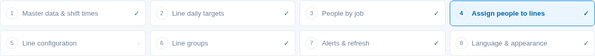
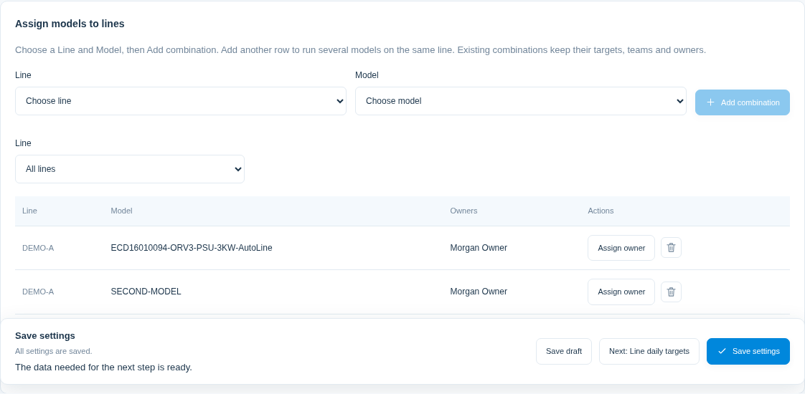
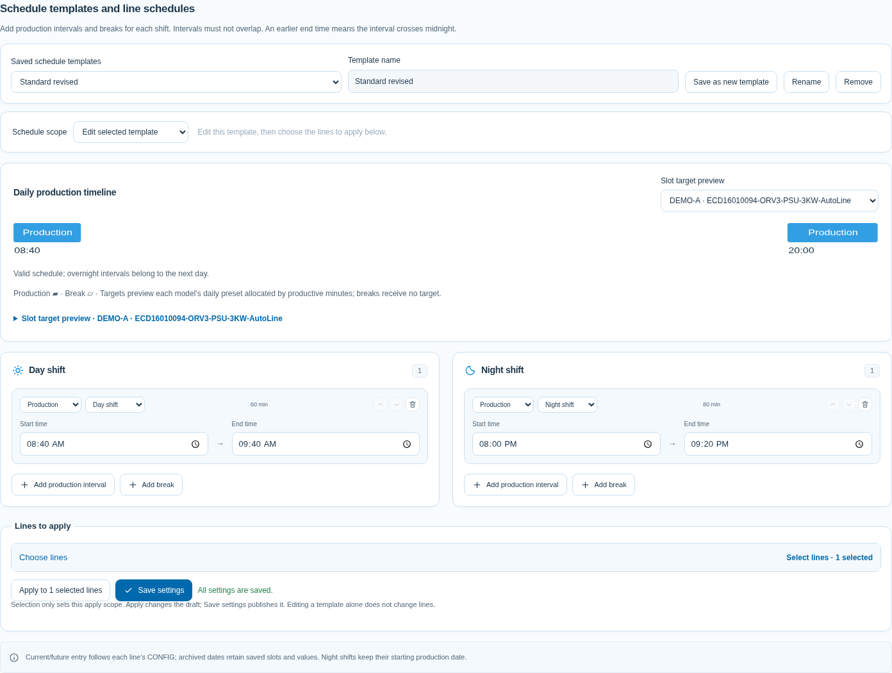
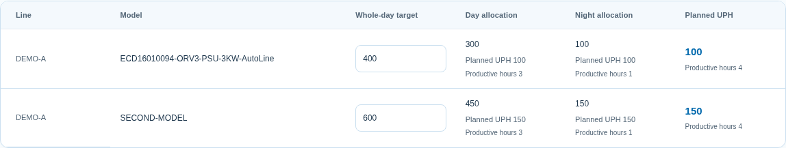
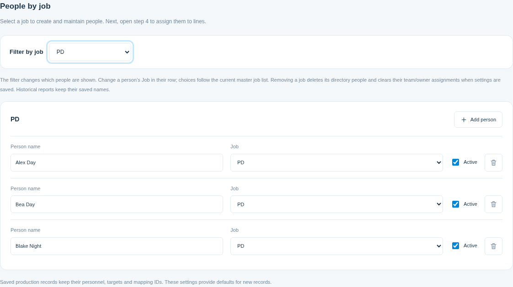
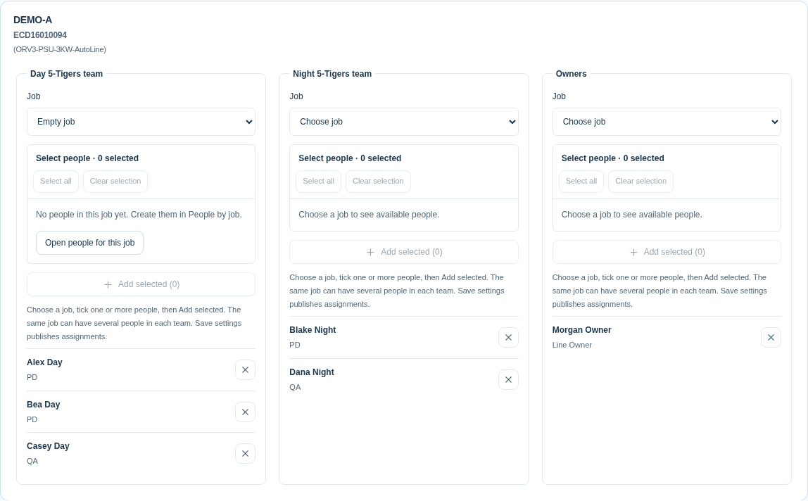
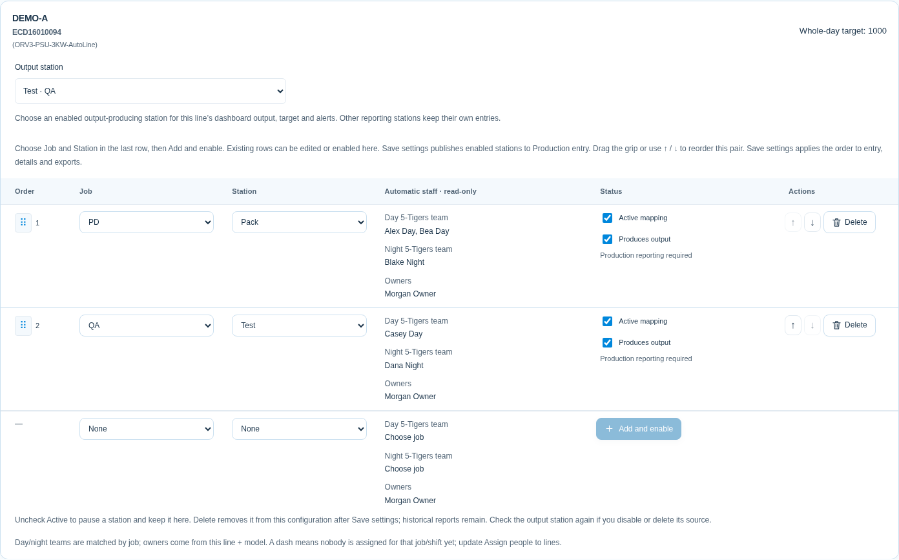
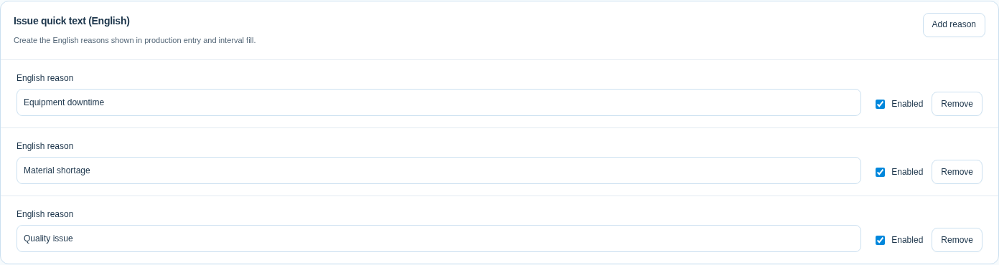
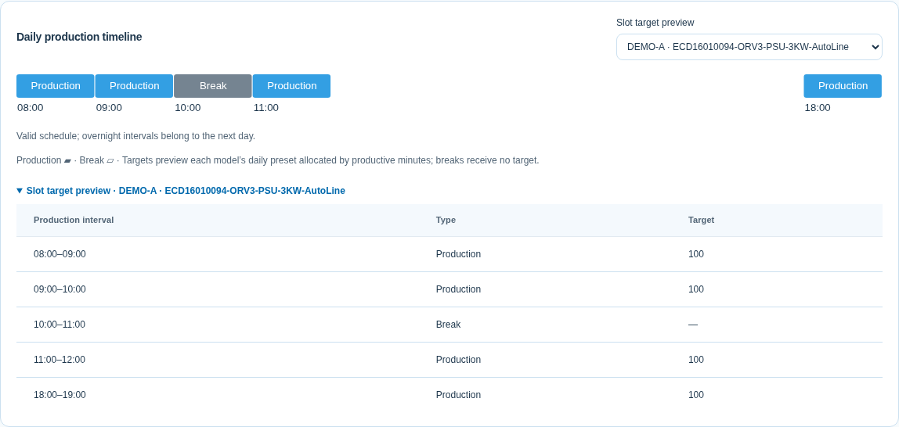

# 管理員設定教學

以 manager 帳號登入，從「更多功能 → 系統設定」進入。截圖使用獨立 DEMO 資料與 English 介面；操作位置與 Chinese／Thai 相同。

## 設定順序

| 步驟 | 頁面                      | 完成內容                                                                 |
| ---- | ------------------------- | ------------------------------------------------------------------------ |
| 1    | Master data & shift times | 產線、Model、職務、站點清單；下拉建立各線 Model 配對；兩班生產／休息時間 |
| 2    | Line daily targets        | 每組產線／Model 的日目標預設；各站依時間分配自己的目標                   |
| 3    | People by job             | 選職務建立、改派或啟用人員                                               |
| 4    | Assign people to lines    | 同組早班、晚班 5-Tigers 與 OWNER；同職務可多人                           |
| 5    | Line configuration        | 下拉選既有配對；同表新增／啟用站點、自動人員及選產量來源站               |
| 6    | Line groups               | 看板分組                                                                 |
| 7    | Alerts & refresh          | 統一告警、門檻及刷新間隔                                                 |
| 8    | Language & appearance     | 共用語言與主題預設                                                       |

完成標記提示進度；每頁只檢查需要的資料。日目標不需先有人員或配置，配置也不等待其他線全部分配完成。

## 基礎資料與日目標

維護 Lines、Models、Jobs、Stations。選 Line、Model 再 Add combination；同線可有多個 Model。後面的配置只會列出這些配對。兩班生產／休息時間不可重疊，夜班午夜後仍屬開班生產日。

## 各產線班表與共用範本

入口：**基礎資料與班別時間**。上方選要編輯的範本，下方勾選要套用的線體。

1. **改預設時間**：在「已儲存班表範本」選「預設班表範本」，下方直接編輯早晚班生產與休息時間。
2. **存另一份範本**：輸入新名稱，按「另存新範本」。可保留多份，如正常班、提早休息班；每份可獨立調整、改名、刪除。
3. **保存範本**：按「儲存設定」。重新整理後，仍能從清單選到已存範本。編輯範本本身不會自動改現有線體。
4. **套用線體**：在「選擇套用線體」勾選需要的線，按「套用至所選線體」，確認後再按「儲存設定」。沒勾選的線維持原設定。
5. **核對結果**：在「班表範圍」選一條線，可看到實際班表，也可個別調整。這裡修改只影響該線，不會回寫範本；同線所有 Model 共用時間。

「複製所選範本」可把上方範本複製到目前選定的線。「套用預設範本」使用原預設時間。刪除範本只移除範本清單項目，已套用的線體班表和已存填報都保留。

每班至少保留一個生產時段；同一線內時段不可重疊，跨午夜仍屬開班生產日。各線可有不同休息時間。批次填寫、目標分配與 Excel 使用所選線的班表；休息中的線會暫停停滯計時。

刪掉時段並套用、儲存後，目前與未來日期的填報欄位、時段按鈕與 Excel 不再顯示該時段。已結束的過去生產日仍可查原時段、數值與異常，原始紀錄不會被刪除。

## 設定日目標

選 Line，分別設定各 Model 日目標。每站預設時段目標＝日目標 × 該段生產分鐘 ÷ 兩班總生產分鐘，排除休息並保留整數全日合計。例如日目標 1,000、總生產 500 分鐘，20 分鐘時段各站取得 40。填報改某站該段為 50，只讓該站當日目標變 1,010，不改其他站或 1,000 預設。

## 建立及分配人員

職務篩選及個人 Job 直接連動目前清單；新增人員後返回分配頁即可選，不必先儲存。改派會帶到新職務；All jobs 維持全部。刪職務會在儲存設定時一併刪除所屬人員與分配，歷史姓名保留；需要時重新建立。

選 Line、Model，在 Day、Night 或 Owners 選 Job，勾選多人，再 Add selected。Select all 全選可加入者；Clear selection 只清待加入勾選；已分配者用 X 移除。同職務每班可多人，各班及各 Model 各自獨立。空職務也會顯示；Open people for this job 可直接開名冊新增或啟用人員。

## 整合產線配置與產量來源

1. 以下拉選 Line，再選該線已配對的 Model；不需多選產線，列內也不再選 Model。
2. 同表最後一列選 Job、Station。早晚班與 OWNER 立即預覽：班員只帶同職務啟用人員，OWNER 帶同組負責人。
3. 按 Add and enable，新增並啟用。既有列可直接改職務／站點或切換 Active，改職務同步更新人員預覽。
4. 只顯示此配對自己的配置，不再列其他 Model 的舊配置。取消 Active 只是暫停，列仍保留、可再啟用；按 Delete 會立即從草稿移除此列，Save settings 後生效，重整也不會回來。未儲存前可用「載入已儲存設定」放棄刪除。同職務／站點若已在表內，請直接編輯或啟用該列。
5. 在同區 Output station 選看板的產量來源站，只列啟用站點。此組的目標、實績、差額、趨勢與警示以該站為準，不加總所有製程站。來源站切換後目前配對的看板立即使用新站；已移除的歷史配對保留保存的來源。
6. 按上方或底部 Save settings 發布。尚未儲存的啟用不會出現在別人的填報頁；沒有啟用站時來源選單會提示先新增。

刪除不會刪歷史填報；重新新增同職務／站點會建立新配置，實績由空白開始，不復活舊數值。停用或刪除來源站後，系統改選另一個啟用站；請確認 Output station 再儲存。刪除最後一站後會顯示尚無站點，來源選單停用。移除配對或清單項目後重新建立，也需重新新增站點，不會讓舊站點自己回來。

## 拖曳設定站點順序

在第 5 步選定 Line／Model，最左欄依序是拖曳把手、序號；移到另一站上半部放在前面，下半部放在後面。職務與站點下拉欄位對齊，↑／↓ 按鈕放在操作欄，鍵盤及手機皆可操作。不同配對分別排序。

按 **Save settings** 後發布順序。整日／整班／單時段填報、站點細節、全螢幕明細及 Excel 範本／CSV 匯出都沿用，已存報表也按此順序顯示。排序不改站點 ID、人員、日目標或所選產量來源。停用站仍保留位置，重新啟用時回到原位置；已刪除的歷史站保留原識別。

填報新增 **Fill interval／同時段批次填寫**，manager 與 member 都可一次套用 Target／Actual／Issue，再個別修改；輸入欄會覆蓋對應舊值，空白套用可清除該欄，也可將時段 Target 恢復為日目標預設配置。操作詳見[填報員教學](./MEMBER_GUIDE.md)。

批次時段直接使用目前 CONFIG 的班表，不比對各站舊時段。改班表後也可直接填報；新時段寫入所選日期，既有時段、數值與異常保留在 SQLite，查看原日期仍可查閱。

## 設定站點是否有產出

在「產線配置」的狀態欄，**啟用配置**決定是否使用此站，**有產出／Produces output**決定此站是否需要生產填報。

| 配置 | 有產出 | 填報行為                                                       |
| ---- | ------ | -------------------------------------------------------------- |
| 啟用 | 勾選   | 顯示站點，可填 Target、Actual、Issue，可納入批次與 Excel 範本  |
| 啟用 | 取消   | 仍按順序顯示，標示無產出免填報，沒有輸入欄；已存資料可展開查閱 |
| 停用 | 任意   | 不建立新填報；有已存報表的日期仍保留歷史站點                   |

按 **Save settings** 發布。舊站預設都有產出，不會因升級被取消。取消有產出不會刪除報表或修改預設日目標；重新勾選可恢復原站填寫，已存數值保留。產量來源只能選啟用的產出站；若取消來源站的有產出，請核對系統改選的來源。若全部無產出，來源選單停用並提示勾選有產出。

批次填寫與 Excel 範本略過無產出站，匯入不接受其修改；CSV 報表匯出仍可包含其已存歷史資料。

## 每個設定步驟的網址

| 步驟           | 路徑                           |
| -------------- | ------------------------------ |
| 基礎資料與班別 | `/settings/master-data`        |
| 日目標         | `/settings/daily-targets`      |
| 建立人員       | `/settings/people`             |
| 分配人員       | `/settings/assignments`        |
| 產線配置       | `/settings/line-configuration` |
| 分組           | `/settings/groups`             |
| 警示           | `/settings/alerts`             |
| 外觀           | `/settings/appearance`         |

可直接開啟或收藏網址，重整仍回同一步；瀏覽器上一頁／下一頁可切換。各步共用同一份未存草稿，離開設定仍會檢查未儲存內容。member 不能透過直接網址進入共享設定。

## 填報為什麼空白

先確認日期、Line、Model。若此配對只有日目標但沒有啟用站點，填報頁會保留選項並預覽時段目標。按 Configure stations for this line/model 直接開該組配置，選職務／站點、啟用並 Save settings，再回填報。預覽中的停用欄位不會儲存報表；不要為了填報重建清單或刪除舊資料。

啟用後所有站直接列出。填報左側只顯示職務／站點，Target、Actual 並排；Issue 點一行摘要開編輯窗，右側顯示合計。人員與 OWNER 仍自動保存，可在生產明細查看。詳見[填報員教學](./MEMBER_GUIDE.md)。新增站預設實績空白，不會繼承別站實績。

## 儲存、交接與異動

Save settings 發布共用設定；Save draft 只留目前瀏覽器／帳號。載入已儲存設定會先確認是否放棄修改；其他瀏覽器的新清單先儲存，再載入。版本衝突保留草稿，勿用舊草稿覆蓋同仁新資料。

改名同步目前設定；移除會先列影響範圍。歷史報表保留姓名、站點、Model、時段與數值。設定修改不會自動改寫報表；目前各站數值獨立。總覽與全螢幕可切時段／每日數字，保留大曲線。全螢幕固定每頁七組，桌面以單列卡片顯示；小螢幕可捲動清單，完整 Model 可在明細查看。

## 異常快捷文字

在「基礎資料與班別」的 **異常快捷文字（英文）** 建立常用原因。每列只填一個英文原因，可停用或刪除；按 **Save settings** 後，啟用項目會出現在逐站異常編輯與批次填寫視窗。清單只保存英文，不需要翻譯或確認流程。

## 統一告警

依照[告警設定與狀態判讀](./USER_GUIDE.md#告警設定與狀態判讀)勾選規則、設定門檻後儲存。計畫 UPH 與截止時間自動取得；到「產線日目標」查看全天、早晚班的唯讀計畫 UPH 與有效工時，修改目標或班表後會重算。

班表編輯器上方新增全天時間軸：主題色為生產、灰色為休息；目標預覽依標示的 Model 日目標分配。新增／修改時間會即時檢查無效時間、超過 12 小時及跨午夜重疊；修正後再儲存。共用範本仍須勾選產線、套用並儲存才會改該線。

## 共用介面與監控卡片

「更多功能」分組提供系統設定及教學。設定、時段範本、日目標、告警及教學沿用同一組主題色、細邊框、圓角與控制項。頂部切換功能，右上角切換語言與主題；手機導覽可橫向捲動。監控狀態分頁可與樓層搭配使用，卡片右側箭頭展開完整告警，點產線名稱開明細。日／時段、日期、班別、匯出與全螢幕功能維持原操作。詳見[總覽操作](./USER_GUIDE.md#查看總覽與產線明細)。

班表套用改用收合的可搜尋面板：展開「選擇產線」，依現有分組或逐線勾選；全選／取消全選可一次調整所有線，數量包含搜尋隱藏的選擇。勾選不儲存設定，套用確認後仍是草稿，按儲存設定後才生效。一般選項自然排序，站點仍以拖曳配置順序為準。詳見[選線操作](./USER_GUIDE.md#儲存及套用時間範本)。
