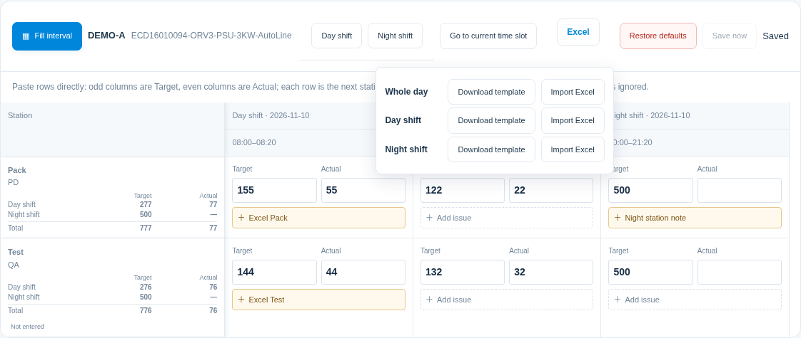
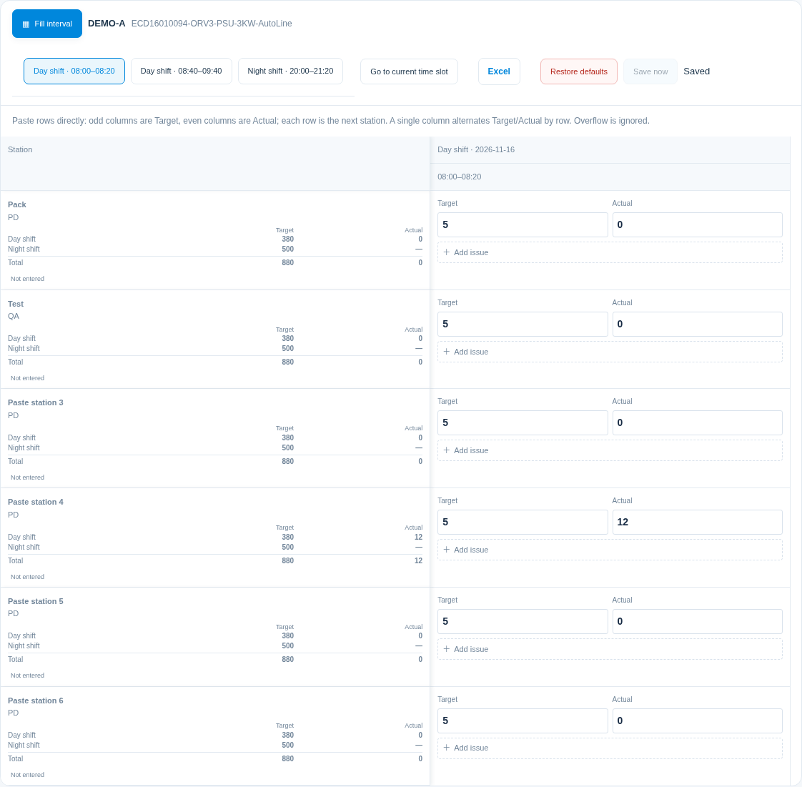
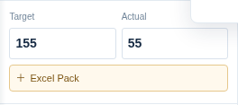
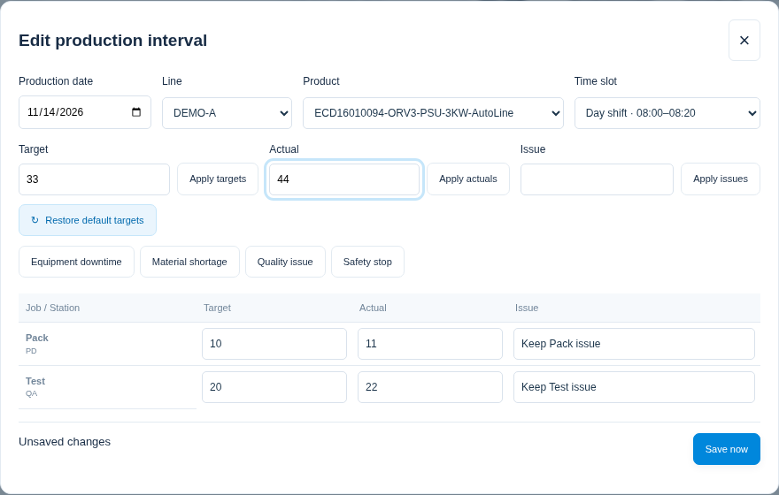
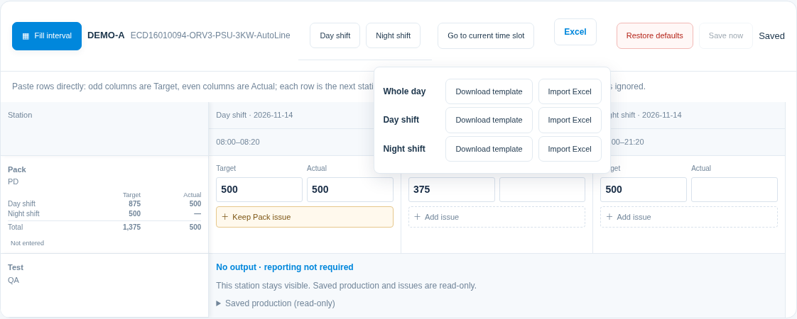
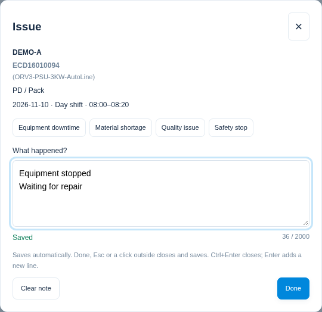
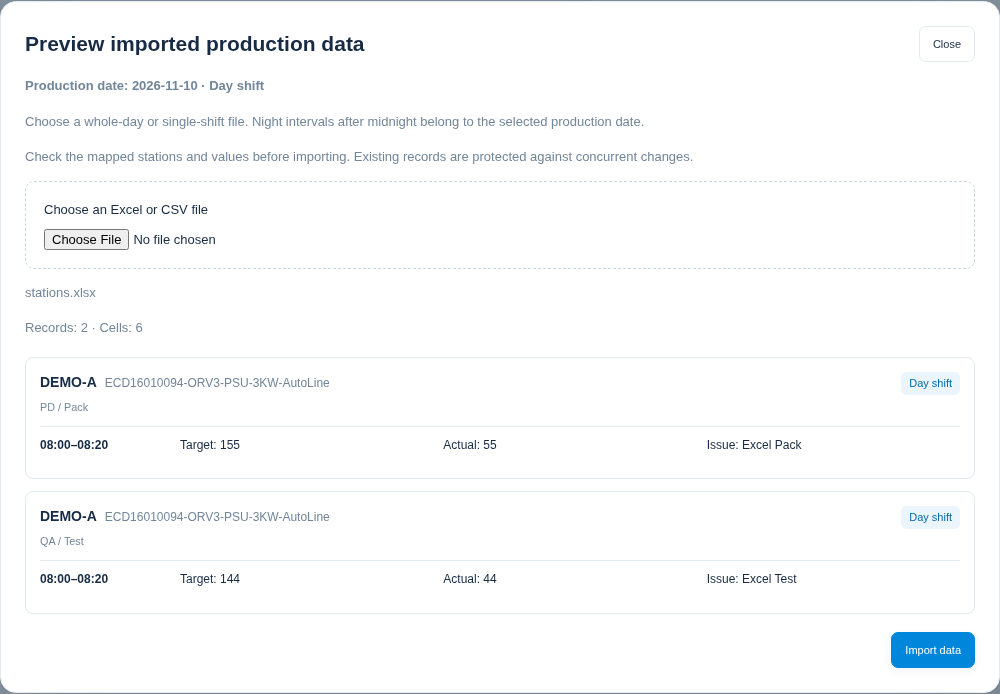
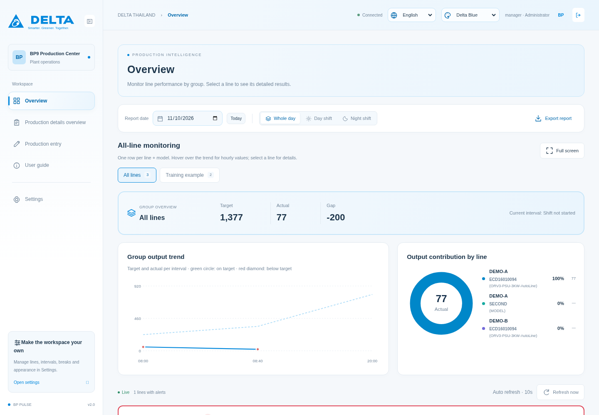
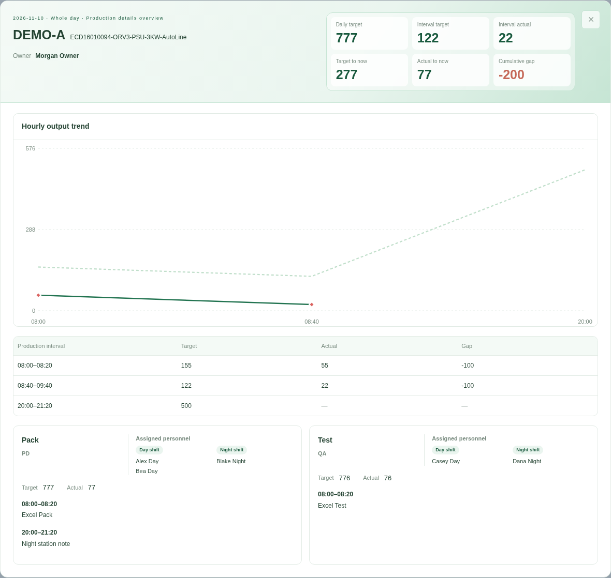

# 填報員操作教學

開啟 <http://10.201.169.250:43871/>，以 member 登入。可填報、匯入及查詢；共用設定由 manager 管理。

## 每站填寫 Target、Actual、Issue

直接貼 Excel 矩形時，每一列對應下一個站點，第 1 欄是 Target、第 2 欄是 Actual，兩欄都留在開始貼上的同一時段；第 3／4 欄才是下一時段的 Target／Actual。若只有單欄，才依上下列交錯為第一站 Target、Actual，接著下一站。只貼剩餘容量可容納的部分，超出值忽略且不繞行。

1. 選生產日期、Line、Model；不需再選站點，下方直接列所有站。
2. 左側顯示站點、職務與早晚班及整日合計。每時段 Target、Actual 並排，直接點選填寫；異常用一行按鈕，不佔大文字框。不同站的數值不會互相同步。
3. 點旁邊或離開儲存格自動儲存，確認 Saved；Save now 會送出全部待存有效資料。

Target 預設依該組產線／Model 日目標與兩班生產分鐘分配，排除休息。可改時段 Target，該站當日目標合計跟著改；不改預設、其他站或其他日期。Actual 輸入 0～99,999,999 整數，空白未填報、0 表示確認零產出。

填報表不列人員與 OWNER；系統仍自動保存，生產明細可查看當時姓名及原時段。產線是主標題，Model 是次標題；請先核對機種。

## 同時段批次設定 Target／Actual

站點依管理員在產線配置儲存的順序排列，整日、單班、單時段與明細均使用此順序。

1. 點填報工具列最左側的 **同時段批次填寫**。工具列與早晚班、前往目前時段、Excel 及儲存放在一起，不會隨表格左右捲動。
2. 選生產日期、Line、Model 與時段；下方可直接修改各站 Target、Actual、Issue。
3. 上方分別輸入目標、實績或異常，按對應「套用」將內容帶入所有站點，視窗保持開啟，可繼續個別修改。Target 旁的「恢復預設目標」會依日目標配置還原此時段各站。快捷文字使用管理員在基礎資料建立的英文原因。空白也可按套用，用來清除所有站點的該欄；0 寫入零。
4. 下方「立即儲存」提交修改且保留視窗。X、Esc 或點視窗外會儲存後關閉；驗證失敗或版本衝突時保留內容與視窗，更新預覽後核對再儲存。
5. 切換日期、產線、Model 或時段前先儲存原範圍，再載入新範圍，避免把資料寫入別組；關閉後填報表回到最後選定的日期與配對。

批次表可貼上相鄰 Target／Actual 兩欄；單欄多列則依序為第一站目標、第一站實績、第二站目標、第二站實績。不合規數字或超出站點範圍會整批拒絕。批次儲存只提交修改欄位，不改其他時段或設定中的日目標。

工具列的 **恢復預設** 會先顯示確認視窗。確認後將所選生產日期、Line／Model 兩班所有產出站點的 Target 恢復為日目標預設配置，並清除 Actual 與異常；取消則完全保留。此操作無法復原，請先核對日期與機種。

## 無產出站點仍顯示、免填報

管理員取消該站「有產出」後，站點仍按順序顯示，標示 **無產出・免填報**，不提供 Target／Actual／Issue 輸入欄。若當天已有資料，可展開「已存生產資料」查閱，原數值與異常不會被清除。批次填寫與 Excel 範本略過此站，使用舊範本修改此站也會被拒絕；需要恢復填寫請管理員重新勾選有產出。

## 名稱顯示與各頁網址

標題保留產線名稱，產品名稱不再加 Model 字樣；用第一個 `-` 切成兩行，例如 `ECD16010094` 及 `(ORV3-PSU-3KW-AutoLine)`，後面的其他 `-` 保留。沒有 `-` 就一行顯示；原始名稱與 Excel 識別不變。

總覽 `/overview`、明細 `/details`、填報 `/entry`、教學 `/guide` 都可直接開啟、重整、收藏及使用瀏覽器上一頁／下一頁。網址仍需登入，member 不能進管理員設定。離開前確認 Saved；瀏覽器重整不會替你送出未儲存內容。

## 異常用一行摘要，點開再填

1. 點該時段「新增異常」或已有的摘要，編輯窗會標明 Line／Model、職務／站點、日期、班別、時段。
2. 可先點管理員在基礎資料建立的英文快捷文字，再補充原因、影響與處置；也可直接打字。Enter 換行，最多 2,000 字元。
3. 按完成、右上角 X、Esc、Ctrl+Enter 或點視窗外，都會關閉並自動儲存；確認上方 Saved。只開啟、不修改不會建立報表。
4. 「清除說明」可清空已填異常，關閉後一樣儲存。長文字在表格只顯示一行摘要，重開可讀完整內容，不會把整列撐高。

停在 Target 或 Actual 時按 **F2** 可直接開該格異常；完成後回原數字欄，繼續填下一格。若儲存失敗，文字保留，左側合計旁會出現重試／檢視最新資料。

## 模式、合計與鍵盤

| 模式                        | 用途             |
| --------------------------- | ---------------- |
| Whole-day spreadsheet       | 早晚兩班整天時段 |
| Whole-shift spreadsheet     | 所選班別所有時段 |
| Single-interval spreadsheet | 選定的一個時段   |

三種模式都保留各站 Target、Actual 與異常按鈕。固定左欄一起顯示職務／站點、早晚班及整日 Target／Actual 合計。日目標預設可在設定頁查看，填報修改不會改它。

工具列的 **早班／晚班** 會切到所選整班，**前往目前時段** 依曼谷時間切到正在生產的單一時段並聚焦 Actual；若所選日期目前沒有生產時段，畫面會顯示原因。

Target／Actual 使用 Tab、Enter、方向鍵移動；可從 Excel 複製任意大小的數字矩形。每列是下一站，來源單數欄貼 Target、雙數欄貼 Actual，每兩欄是同一時段；單欄資料才依上下列交錯 Target／Actual。超出目前位置剩餘容量的部分忽略。空格保留空值，0 保留零；可容納範圍內若有不合規數字，整次貼上會拒絕。Issue 支援一般文字貼上及換行。無法填的歷史時段顯示 —，不會猜測時間。

## 沒有站點或不能儲存

若看到「尚無啟用站點配置」，表示此 Line／Model 尚未由 manager 啟用站點並儲存。頁面仍有產線／Model 及目標預覽；請管理員依提示完成配置，預覽不能建立報表。

管理員停用或刪除站點後，該站不再建立新填報；已儲存日期的歷史填報仍保留。刪除後重新新增同站點是新配置，不會自動帶回原實績。

無效值會標記該格；網路失敗保留輸入，可重試。版本衝突先 Review latest，再選 Use latest data 或 Save my changed cells；只合併自己改過的欄位，其他站不受影響。處理未存資料前不能離開頁面；切換日期／Model 不會把待存內容寫到別組。

## Excel 匯入

先展開「Excel 匯入與範本」，依生產日期、班別下載範本，保留 Row ID、Line、Model、Job、Station、Time slot、Date、Shift。各站列分別填 Target、Actual、Issue；空格保留原值，0 寫入零。Excel 選單可選整日、早班或晚班；整日範本包含兩班並可一次匯入。

範本欄位依序為 **Date、Shift、Line、Model、Job、Station、Time slot、Target、Actual、Issue、Row ID**。淡黃色區是填寫區；左側識別欄與表頭已固定，所有欄位都可篩選。列按產線／Model、已設定站點順序排列；全天時每站先早班再晚班，跨午夜時段維持班表順序。匯入預覽也採此順序，並分開顯示職務／站點與班別。

[下載 DEMO 整日範本](./examples/production-import-template.xlsx)可查看格式；正式填報請從系統下載符合日期與現場站點的範本。舊範本仍按欄名識別，不要求改成新欄位順序。

CSV 可用 Row ID＋Time slot，或可唯一識別的 Line＋Model＋Job／Station＋Time slot。只有產線／Model 且有多站時會拒絕，不會自動同步或挑站。預覽確認所有站點、數值及錯誤後按 Import data；任一站或設定版本衝突會整批拒絕。要清空已存欄位請回畫面編輯，匯入空格不會清除資料。

## 看板、來源與歷史

左側台達標誌下方為功能導覽，選取中的頁面有主題色細條。右上角保留語言及配色選單；頂部、篩選與合計卡會跟隨主題。圖表與警示仍按原有資料及規則顯示。

總覽預設 **全天**，目標、實績及差額合併早晚班；生產總覽與生產細節上方都可切換全天、早班或晚班。每組產線／Model 仍採 manager 指定的來源站，不把所有站產量相加。

全螢幕點線開彈窗，頂部使用目前主題的淡色層次，集中顯示產線、完整機種、負責人、目標、實績與差異；各站人員分早班、晚班標示。每小時產量圖使用彈窗完整寬度並加高，下面保留逐時段表格與各站異常。X／Esc 關閉後保留分組及頁次。

本版仍需手動填報，未填不會當作零；未來規劃自動接資料。歷史報表不會因更改基礎清單而被清除。
