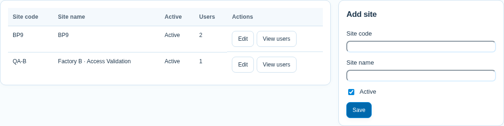
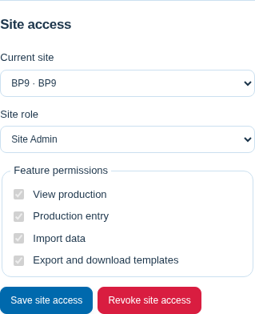
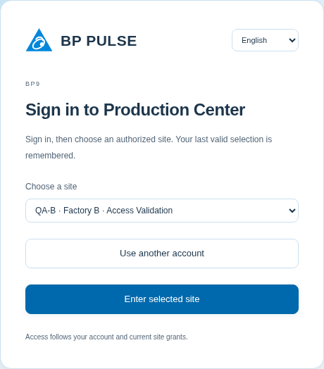

# Phase 1：多廠區、帳號與資料隔離

## 操作方式

1. **System Admin** 登入後從左側「管理」的懸浮子選單選擇「廠區管理」，輸入唯一代碼、名稱並儲存。編輯可更改代碼、名稱或啟用狀態；停用保留資料及授權紀錄。
2. 按「查看使用者」開啟該廠區名冊。在「管理」懸浮子選單的「使用者管理」新增帳號；新密碼至少 8 字元，帳號使用英數、`_ . @ -`。使用者預設只有查看權限。
3. 編輯帳號的「廠區授權」，選擇廠區、Site Admin／User 與功能後儲存。若要把既有帳號加入另一廠區，先把名冊切為「全部使用者」再選帳號。同帳號在不同廠區可有不同角色。
4. **Site Admin** 只能建立目前廠區的一般使用者、調整其功能或撤銷權限；不能指派 Site Admin、變更全域帳號資料或重設既有帳號密碼，以免影響其他廠區。
5. **User** 依授權查看、填報、匯入或匯出。匯入必須同時有填報權限。Site Admin 隱含具有該廠區全部功能；System Admin 隱含具有所有廠區權限，不能用個別廠區授權限制其全域角色。

登入先驗證帳密，再顯示可選的已啟用廠區，避免匿名枚舉廠區。已有有效的上次廠區會自動使用；上次廠區停用或權限被撤銷時，必須重新選擇。頂部「目前廠區」可切換，側欄與全螢幕也顯示廠區名稱。切換前先處理未儲存的填報；未儲存設定會要求確認。

切換會重新載入工作區，清除舊廠區的記憶體、匯入預覽及填報佇列。其他分頁若仍持有舊廠區／版本，API 會拒絕並要求重新載入。設定草稿按 `user_id + site_id` 保存；舊版草稿只允許在原預設廠區讀取。視覺主題及語言仍是個人瀏覽器偏好。

一般登入為瀏覽器 Session Cookie，伺服器最長 8 小時；「記住我」為 30 天。密碼與登入 Token 不寫入 LocalStorage。登入帳號與生產現場的人員名冊是不同資料，建立帳號不會自動建立當班人員。







## 架構與權限

沿用原生 Node.js HTTP、`node:sqlite`、scrypt 密碼雜湊與資料庫 Session；沒有新增 ORM、JWT、第三方執行期依賴或獨立廠區服務。

| 操作 | System Admin | Site Admin | User |
| --- | --- | --- | --- |
| 新增、修改、停用廠區 | 全部 | 不可 | 不可 |
| 全域帳號、密碼、System Admin 角色 | 全部；不能停用最後一位有效 System Admin | 不可 | 不可 |
| 廠區使用者授權 | 全部 | 目前廠區的既有一般使用者，或剛建立的新帳號 | 不可 |
| 指派 Site Admin | 可以 | 不可 | 不可 |
| 廠區設定 | 所選廠區 | 所選且具管理員角色的廠區 | 不可 |
| 生產資料 | 可切換所有已啟用廠區 | 所選且授權的廠區 | 所選廠區及已勾選功能 |

授權在每個請求由伺服器重新查詢，並在交易內再次驗證，避免讀取 Request Body 期間遭撤權後仍能提交。即使沒有前端 Header，也會比對請求開始時的 Session 廠區與版本，禁止在 Body 串流期間把寫入改指向另一廠區。廠區、角色或密碼變動會使既有權限／Session 立即失效或更新；密碼重設、全域角色變更與停用帳號會撤銷該帳號全部 Session。

一般使用者的功能碼為 `production.read`、`production.write`、`data.import`、`data.export`。查看是最低權限，匯入依賴填報。整筆生產紀錄刪除維持管理員限定，沒有改變原有填報規則。

## 資料表與關聯

| 資料表 | 重要欄位／用途 |
| --- | --- |
| `sites` | `id`、唯一且不分大小寫的 `site_code`、`site_name`、`is_active`、`created_at`、`updated_at` |
| `users` | 保留原 username 主鍵、雜湊及 legacy role；新增唯一 UUID `id`、`system_role`、`display_name`、`is_active`、`last_site_id`、時間戳記 |
| `user_sites` | `user_id → users.id`、`site_id → sites.id`、`role`、JSON `permissions`、時間戳記；複合主鍵 `(user_id, site_id)` |
| `sessions` | 保留雜湊 Token、username、到期時間；新增 `site_id`、`site_version`、`remember_me` |
| `site_settings` | 正式廠區設定來源；`site_id` 為非空主鍵及 FK，`value` 保存該廠區 JSON |
| `site_rows` | 全域唯一站點 ID 及所屬廠區；FK／索引與寫入 Trigger 阻止站點歸屬不一致 |
| `security_audit` | 具 FK 的操作者／廠區、操作、無密碼的 JSON 摘要、時間 |
| `schema_migrations` | 版本、遷移時間、前後筆數及備份位置 |

既有 `production_records`、`record_revisions`、`production_activity`、`audit_log`、`import_previews` 及 legacy `app_settings` 加入非空 `site_id`、FK 與索引。生產、版本及活動查詢另有 `(site_id, date, shift, row_id)` 索引；預覽包含廠區及使用者。

**沒有刪除或重建既有生產資料表。** 舊主鍵 `(date, shift, row_id)` 保留，因此站點 ID 必須全域唯一，由 `site_rows` 在交易內配置。相同廠區代碼／站點名稱可出現在不同廠區設定，實際站點 ID 仍不同；原有站點 ID、快照及關聯不變。

原 `app_settings` 有 `CHECK(id=1)`，無法直接塞入第二個廠區。它保留作為預設廠區的相容投影，Trigger 與 `site_settings(site_id=1)` 同步；其他廠區不使用此表。所有正式 API 都讀寫 `site_settings`，不是 legacy 全域設定。

權限判斷使用 `users.system_role` 與 `user_sites.role`；原 `users.role` 只保留相容欄位。API 的 `user.role=admin/operator` 是依目前廠區算出的舊前端相容值，不是全域管理權限。

已有穩定 `user_id`、`site_id`，未來可另建 `UNIQUE(user_id, site_id, list_id)` 的個人排序資料，分別 FK 至使用者與廠區並沿用授權檢查。本階段沒有開發排序、進階報表或新生產模組。

## API

| API | 權限／用途 |
| --- | --- |
| `POST /api/auth/login` | `{username,password,rememberMe?,siteId?}`；驗證後回傳使用者及 Cookie；沒有有效預選廠區時回傳 `needsSiteSelection` |
| `GET /api/auth/me` | 目前角色、廠區、可用廠區、功能與 Session 到期時間，不回傳密碼或 Token |
| `POST /api/auth/site` | `{siteId}`；查驗授權及啟用狀態後更新 Session、遞增廠區版本並記住選擇 |
| `POST /api/auth/logout` | 刪除目前 Session、清除 Cookie |
| `GET /api/sites` | 只列本帳號可進入的已啟用廠區及各自角色 |
| `GET /api/admin/sites` | System Admin；包含停用廠區及名冊數量 |
| `POST /api/admin/sites` | System Admin；`site_code`、`site_name`、可選 `is_active` |
| `PATCH /api/admin/sites/:id` | System Admin；修改代碼、名稱或啟用狀態 |
| `GET /api/admin/users?site_id=` | System Admin 可查全部／篩選名冊及完整授權；Site Admin 只可查目前廠區，回傳授權也限於該廠區 |
| `POST /api/admin/users` | 新增帳號；System Admin 可指定全域角色及廠區角色，Site Admin 僅可建立目前廠區的普通帳號 |
| `PATCH /api/admin/users/:userId` | System Admin；顯示名稱、全域角色、啟用狀態或密碼。username 不改名，保留歷史身份 |
| `PUT /api/admin/users/:userId/sites/:siteId` | 設角色／功能；Site Admin 不可操作其他廠區、管理員或非本廠區的既有帳號 |
| `DELETE /api/admin/users/:userId/sites/:siteId` | 撤銷授權，不刪生產歷史；相同權限限制 |

原 `/api/config`、`/api/defaults`、`/api/records`、`/api/records/:id`、`/api/entry/records/:id`、`/api/entry/interval`、`/api/import/template`、`/api/import/preview`、`/api/import/apply`、`/api/export` 全部改為 Session 廠區範圍。

後端從 Session 及當下授權決定廠區；Payload、Query 或 Header 不能自行選資料範圍。普通資料 API 中出現不一致的 `site_id`／`siteId` 會拒絕。前端傳送 `X-Site-ID`／`X-Site-Version` 只是防止舊分頁誤提交的斷言，不能用來授予權限；沒有 Header 的舊客戶端仍受 Session 廠區限制。

所有業務 SQL 透過 `siteQuery` 顯式綁定 `:site_id`，設定由 AsyncLocalStorage 保留在請求內，避免程序共用變數把另一廠區資料混入。ID 查詢同時驗證目前設定／全域站點登錄及 SQL 廠區；匯入 Token 同時綁使用者、廠區、期限與版本。

## Migration、備份與回復

上線前先停止全部舊版 worker，避免混用舊版不具廠區隔離的 SQL。保留目前程式版本；本階段前的版本為 `6968b22`。

```sh
npm run db:backup
npm run db:verify
```

可指定路徑，例如 `npm run db:backup -- data/production.sqlite data/backups/before-phase1.sqlite`；目的檔已存在時拒絕覆寫。工具使用 SQLite online backup，包括已提交的 WAL，不是直接複製主檔。

新版本首次啟動會：

1. 在任何升級寫入前，自動備份既有資料庫至同目錄下 `backups/before-multi-site-*.sqlite`；備份失敗就停止啟動。
2. 在單一遷移交易建立預設廠區（`data/template.json` 的 plant，通常 BP9），把舊業務資料歸入 `site_id=1`；保留原主鍵、JSON、帳號名稱與密碼雜湊。
3. 只把既有 `manager` 管理員作為預設 System Admin；更早版本若只有 `admin`，則選該帳號。非標準帳號請在**首次升級前**設 `BP_SYSTEM_ADMIN_USERNAME` 指向既有管理員。沒有明確可用帳號就中止，不會把所有人升為 System Admin。
4. 其他舊 admin 成為預設廠區 Site Admin，舊 operator 成為 User，保留原本填報／匯入／匯出能力；上次廠區與舊 Session 都歸到預設廠區。
5. 在提交前比對業務表筆數及 Foreign Key，成功才提交並啟用服務。SQLite 加欄位時僅於啟動連線暫停 FK 檢查，驗證後恢復；非空約束與 FK 在服務開始接收請求前已有效。
6. 記錄 `multi-site-v1`；後續啟動不重複遷移或重新提升角色。失敗會回滾該遷移交易、停止啟動，保留升級前備份供回復。

成功後執行 `npm run db:verify`，應看到 `integrity=ok`、`foreignKeyViolations=0`、`multiSite=true`。重複或不一致的舊資料應先從錯誤與備份確認，不要直接刪表強行重跑。

若需要回復：先停止**所有**應用程式 worker，再執行：

```sh
npm run db:restore -- data/backups/before-phase1.sqlite data/production.sqlite --offline
```

`--offline` 是操作者確認已停機，工具不會代替你停止其他程序。工具會先保存目的資料庫的一致性救援備份，驗證來源與暫存副本，再替換並清除停機目的庫的舊 WAL／SHM。沒有 `--offline` 拒絕覆寫。

**回復必須同時恢復舊程式與升級前資料庫。不能只回退程式、繼續使用多廠區資料庫，否則舊版 SQL 沒有隔離能力。** 回復升級前備份也會回退升級後寫入的資料；需先評估／保留救援備份，不能自動覆寫正式資料。若重新啟動新程式，它會再次執行升級。

正式 HTTPS 部署請在可信任反向代理後設定 `BP_TRUST_PROXY=true`、`BP_COOKIE_SECURE=true`，代理須保留原 Host 並清除偽造的 forwarded headers。Cookie 為 HttpOnly／SameSite=Strict；TLS 或上述設定下加 Secure。本機 HTTP 開發保留可用性。

## 實際驗證與交付範圍

測試覆蓋 System Admin 管理、Site Admin 限界、同帳號跨廠區角色、唯讀功能、URL／Payload／Header 篡改、外廠資料 ID、雙廠並行查詢、跨廠／跨帳號匯入 Token、撤權、停用保留歷史、Session Cookie、記住我、登出及回復工具。

Migration 使用非空舊資料 fixture 驗證 `0`／`NULL`、原始 JSON、站點 ID、帳密及筆數不變，並驗證重複執行、故障回滾、WAL 備份及停機回復。另將工作區實際資料庫以唯讀方式備份至臨時副本再驗證；該副本目前有 **0 筆生產紀錄、1 筆設定**，帳密雜湊及原資料保留、FK 違規為 0。

**本次沒有遷移或覆寫工作區／正式部署資料庫。** 正式資料的實際升級在部署啟動時執行，須按上面停機、備份及驗證流程操作。測試只使用獨立 SQLite 與測試廠區／帳號，沒有寫入正式資料。

目前維持原本曼谷生產時區；不同國家時區、SSO、使用者自行改密碼、進階跨廠報表及個人清單排序都不是本階段功能。完整檢查數量與限制見 [VALIDATION](./VALIDATION.md)。

## 修改檔案導覽

- 後端：`server.mjs`、`auth.mjs`；新增 `site-migration.mjs`、`site-access.mjs`、`site-management.mjs`。
- 前端：`public/app.js`、`entry.js`、`index.html`、`pages.js`、`i18n.js`、`help.js`；新增 `site-management.js`、`site-management.css`、`site-messages.js`。
- 驗證／工具：新增 `tests/multi-site.test.mjs`、`scripts/site-management-audit.mjs`、`scripts/database-maintenance.mjs`；更新既有登入／教學測試與 browser-smoke。
- 文件／設定：README、CODE_GUIDE、中英使用教學、管理員／填報員教學、VALIDATION、本文件、必要教學截圖、`package.json` 及 `.gitignore`。資料庫、備份及帳密不提交 Git。
