# BP9 Production Center guide

Open your deployed Production Center. A manager account manages shared settings; a member account enters production, imports and reviews reports. The in-app User guide follows the logged-in role. Language choices are Chinese / English / Thai in every interface language.

The refreshed shell uses DELTA branding, a soft theme-coloured header, an active navigation marker and consistent filter/card spacing. Language, theme and account controls stay in the upper-right corner; sidebar collapse and all production actions remain available. [Overview screenshot](./images/production-overview.png).

## Manager: eight setup steps

1. **Master data & shift times:** maintain Lines, Models, Jobs, Stations and the English issue quick-text list. Add each allowed Line/Model pair with dropdowns; one line can use several models. Define production/break intervals for both shifts without overlap.
2. **Line daily targets:** set one preset per line/model before people or stations are complete. Every station starts with that preset allocated by production minutes across both shifts, excluding breaks.
3. **People by job:** use the complete job list, including empty jobs. Create, move or activate people. Removing a job deletes its directory people/assignments when saved; historical captured names remain.
4. **Assign people to lines:** choose Line/Model and a Job in each day/night/owner team. Tick several names and Add selected. The same job can have multiple people. Clear selection only clears pending ticks; X removes an assigned person. Empty-job guidance opens its roster.
5. **Line configuration:** choose a configured Line/Model with dropdowns. Only this pair’s configurations appear; old models are not suggested or copied. One table contains Job, Station, automatic people, Active and Delete. Its last row adds and enables a new pair. Uncheck Active to pause and keep the row; Delete removes it from the draft and Save settings publishes its removal. It stays deleted after reload. Re-adding the same pair creates a new identity without reviving old counts; historical reports remain. Existing pairs should be edited or enabled in their own row. Select **Output station** here; recheck it if you disable or delete its source. Deleting the last station leaves an empty configuration with the source selector disabled.
6. **Line groups:** organize physical lines and their models.
7. **Alerts & refresh:** configure gap/idle rules and refresh interval.
8. **Language & appearance:** shared defaults; browser preferences are in the header.

Save settings at top/bottom publishes the draft. Save draft stays in this browser/account. Page access checks actual prerequisites rather than locking every subsequent step. Version conflicts preserve drafts. Load saved settings confirms before discarding local changes.

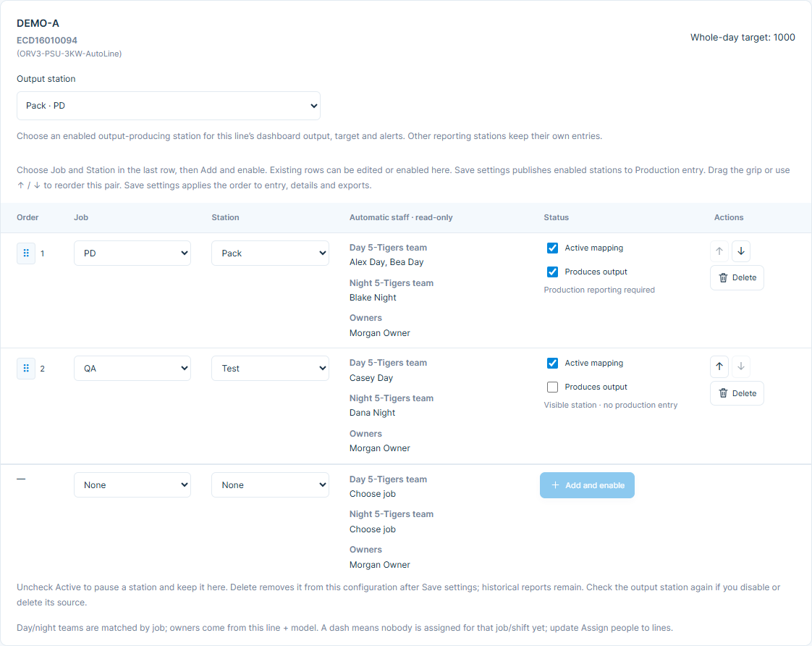

## Member: each station has its own counts

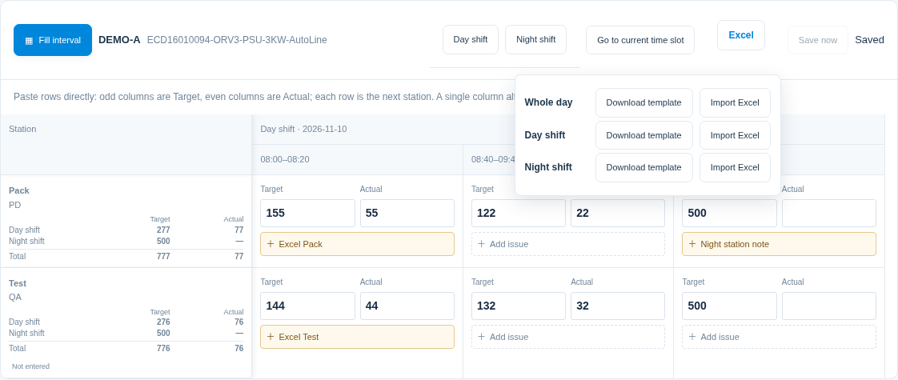

Paste the spreadsheet rectangle directly: each source row is the next station, column 1 is Target and column 2 is Actual in the same interval. Columns 3/4 are the next interval. A single source column alone alternates Target/Actual down the rows. Overflow is ignored and never wraps.

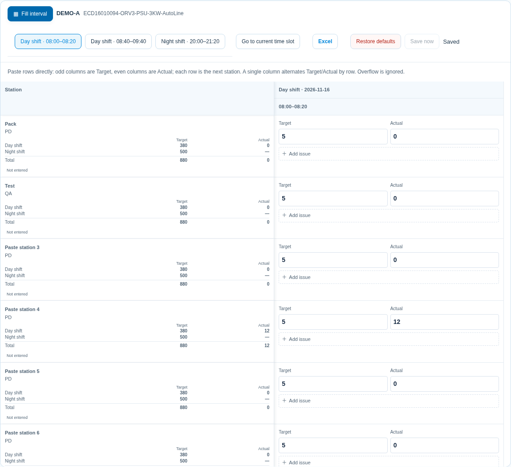

Choose production date, Line and Model. All stations appear automatically; there is no station selector. The fixed left column shows Job/Station and day/night/whole-day totals. Each interval has adjacent **Target / Actual** inputs and a one-line issue button. Individual edits affect only that station. People and owners remain automatically captured and can be viewed in production details.

Interval target = daily preset × interval production minutes ÷ total production minutes across both shifts. Breaks are excluded and rounding preserves the daily total for each station. A preset of 1,000 over 500 minutes gives a 20-minute interval 40. Changing one station’s Target to 50 changes only that station’s report-day total to 1,010, leaving other stations and the 1,000 preset unchanged.

Whole-day spreadsheet shows both shifts; Whole-shift spreadsheet shows the selected shift; Single-interval spreadsheet shows one slot. All modes keep Target/Actual and issue buttons. Day/night and whole-day Target/Actual totals stay with Job/Station in the fixed left column. Blank means not entered/unknown; 0 is explicit zero. Counts must be integers from 0 to 99,999,999.

The **Day shift** and **Night shift** buttons open that complete shift. **Go to current time slot** uses Bangkok time to open the active single interval and focus Actual; when the selected production date has no active interval, the page explains why.

**Restore defaults** opens a confirmation dialog, restores Target from the daily preset allocation, and clears Actual and Issue for every output station in the selected Line/Model across both shifts on that production date. In Fill interval, applying an empty shared field clears that field for every station; **Restore default targets** restores the selected interval from the daily preset allocation, and zero remains an explicit zero.

Click another numeric cell to autosave and confirm Saved. Tab moves across intervals within the same field; Enter moves down stations. In a pasted rectangle, each row is a station and adjacent Target/Actual columns stay in one interval; later column pairs continue to later intervals. A one-column list alternates Target/Actual down the rows. Values beyond the remaining grid capacity are ignored instead of wrapping. Failed saves retain input. Review a station version conflict before Use latest data or Save my changed cells; only changed cells are merged and other stations stay independent.

Click **Add issue** or its preview, or press **F2** in a numeric cell. The editor identifies the station, date, shift and interval. Quick text inserts equipment, material or quality reasons; edit freely and use Enter for new lines, up to 2,000 characters. Done, X, Esc, Ctrl+Enter or a click outside closes and saves. Clear note removes the saved note. Opening without changes never creates a report. Long notes stay one line in the table; reopening shows the full text. F2 returns to the original numeric cell after closing. Save failures retain text and expose recovery controls beside the totals.

Overview defaults to the **Whole day** production scope, showing both shifts in its curves. The separate Interval / Daily switch controls the card numbers. Whole day / Day / Night is available in both Overview and Production details. In fullscreen details, the header follows the active colour theme and groups Line, Model, Owner and the six interval/daily/cumulative metrics; each station labels Day and Night personnel separately. The hourly chart fills the dialog width at a larger height.

Use **Interval / Daily** beside the overview title or in the fullscreen header. The selected mode persists after refresh. Interval shows the active slot’s target, actual and gap. Daily shows the complete two-shift target, reported actual and gap, regardless of the Day/Night filter. A gap is actual minus target; missing values stay — and explicit zero stays 0. During breaks, outside production hours or on historical dates, switch to Daily to see totals.

Per-line Target/Actual curves take the main card space and use the actual plot dimensions. Desktop fullscreen retains seven units per page; tablet and phone cards give the curve its own row. Details retain the six interval/daily/cumulative metrics and the hourly table. Output-share and shortfall rules continue using cumulative actuals through started intervals, independently of the card display mode.

The group output trend keeps every time label readable. Dense schedules scroll horizontally inside the chart, including fullscreen, without widening the page. Hover or Tab to an interval for its Target/Actual tooltip. Refresh retains the chart's scroll position.

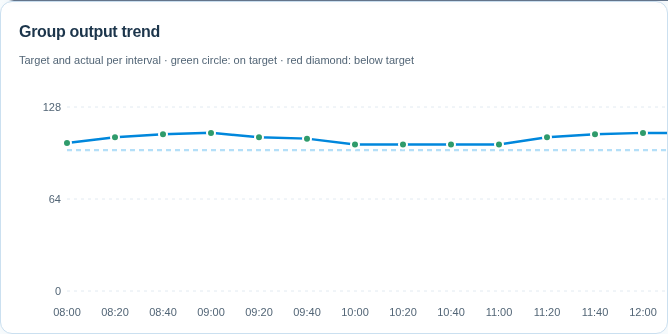

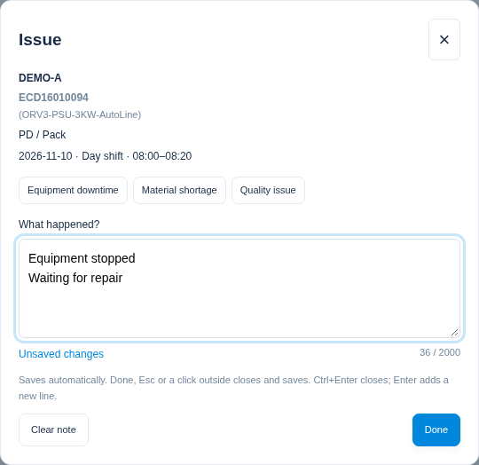

## Saved station order

Managers drag the grip in the far-left Order column to place a station before or after another station in the same Line/Model. The sequence number follows the grip. Job and Station inputs align, and up/down buttons are in Actions. **Save settings** publishes the order to all entry modes, station details, fullscreen dialogs and Excel templates / CSV exports. Station IDs, people, targets and the selected output source remain intact.

## Fill an interval across all stations

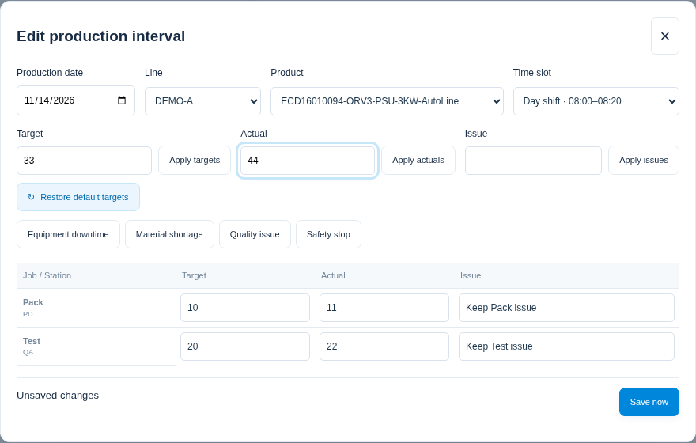

In Settings → Master data & shift times, choose Default schedule template to edit the initial times, or select another saved template. Enter a name and Save as new template to keep multiple schedules. Adjust production/break times and Save settings. Editing a template alone does not change existing lines.

Tick the desired Lines to apply, Apply to selected lines, confirm and Save settings. Use Schedule scope to inspect the actual line schedule. All models on that line share the result. Rename/Remove manage the template list; deleting a template retains applied line copies and saved reports.

Current/future station fields, interval buttons and Excel use the selected line’s current CONFIG only. Removed slots disappear. Archived production dates retain saved original slots and values; an active overnight shift still uses the current schedule. See the focused template screenshot below.

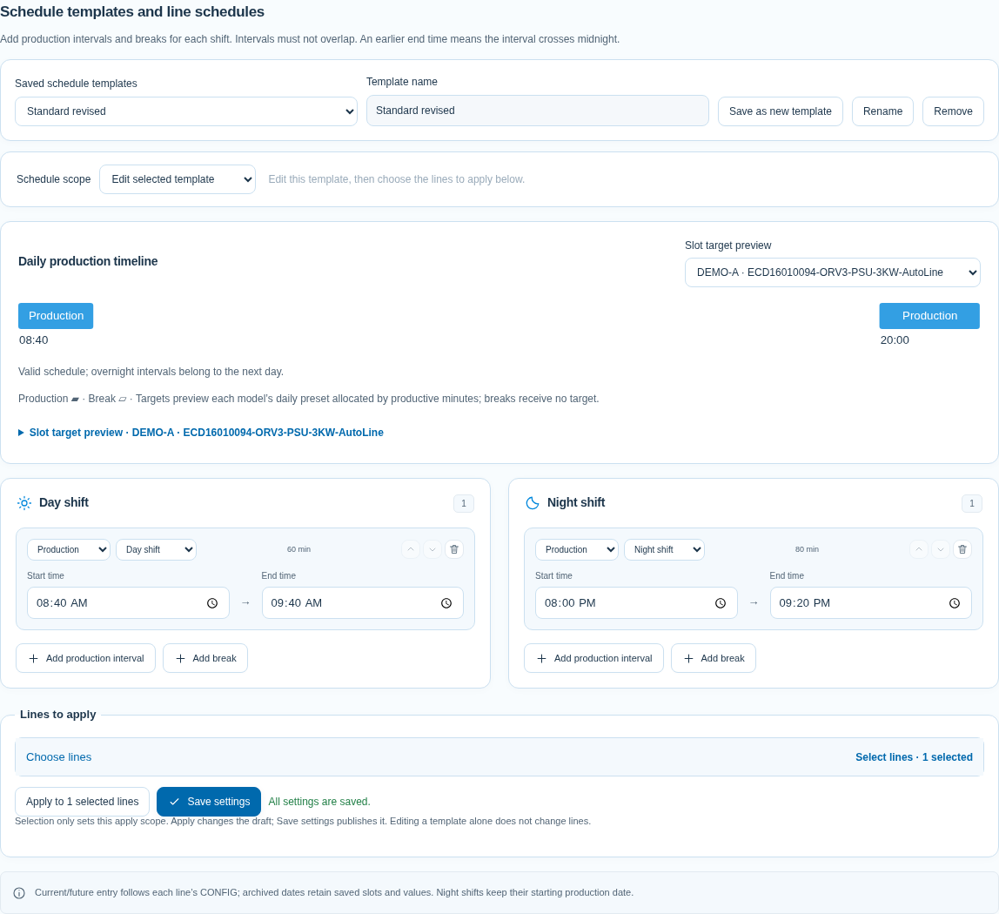

Fill interval uses the selected line’s current CONFIG schedule directly, without matching saved historical intervals. Schedule changes do not block entry: new slots are saved on the selected date, while original slots, values and issues remain in SQLite and can be viewed on their original dates.

Click **Fill interval** at the left of the entry command bar. Select production date, Line, Model and interval. Edit Target, Actual and Issue for each station, or enter a shared value above and use its Apply button. Applying stays in the window for further edits. **Restore default targets** restores this interval from the daily preset allocation. English issue quick text configured in Master data is also available. Applying a blank shared field clears that field; zero writes zero.

**Save now** saves without closing. X, Esc or clicking outside saves before closing; invalid values or conflicts keep the window and drafts open. Changing date/unit/interval saves the original scope before loading the destination. Closing returns entry to that destination. A conflicting batch saves nothing; Refresh preview retains changed fields for review before retrying.

Paste adjacent Target/Actual columns into the batch sheet, or a single column alternating Target then Actual for each station. The main grid also maps each source row to a station and each adjacent Target/Actual column pair to one interval. Invalid values inside the available area are rejected; overflow outside the main grid is ignored. Other intervals and daily presets stay unchanged.

## Stations without output

Managers leave a station **Active** and uncheck **Produces output** to keep it visible without reporting. Save settings publishes the choice. Existing stations produce output by default. Non-output rows have no writable Target/Actual/Issue; expand saved history to read prior data. Batch fill and Excel templates skip these stations, and import rejects changes to them. CSV report export can still include their saved history. Re-enabling output restores entry without deleting earlier records. Output source choices include only enabled output-producing stations.

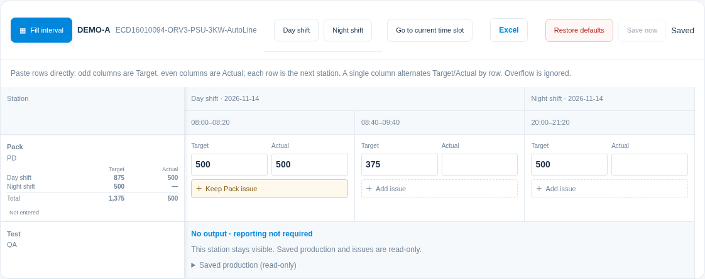

## Names and page addresses

Display headings omit the Model prefix and split at the first hyphen: `ECD16010094` then `(ORV3-PSU-3KW-AutoLine)`. Further hyphens remain inside the parentheses. Names without a hyphen use one line. Stored identifiers and Excel values remain unchanged.

Every page has its own address: `/overview`, `/details`, `/entry`, `/guide`. Manager setup paths are `/settings/master-data`, `/settings/daily-targets`, `/settings/people`, `/settings/assignments`, `/settings/line-configuration`, `/settings/groups`, `/settings/alerts` and `/settings/appearance`. Direct links, refresh and browser Back/Forward are supported. Settings steps share an unsaved draft; leaving still checks unsaved work. Member accounts cannot access shared settings by URL. Confirm Saved before refreshing.

## Missing configuration

A configured line/model with no enabled stations remains selectable and shows its target-allocation preview. Preview fields do not create reports. Managers can open the exact Line configuration, add/enable its job/station pairs and Save settings. Members see instructions to contact a manager. Do not delete catalogs or recreate people to make entry appear.

## Excel import

Expand **Excel import & templates**, download the production-date/shift template and retain identifiers. Enter Target, Actual and Issue on each station’s own rows; different counts at different stations are valid. Blank cells preserve saved values; 0 writes zero. The Excel menu offers whole-day, day-shift and night-shift templates and imports. A whole-day file contains both shifts.

Columns are **Date, Shift, Line, Model, Job, Station, Time slot, Target, Actual, Issue, Row ID**. Yellow cells identify the input area. The header and identity columns stay frozen, with filters covering every column. Rows follow line/model and configured station order; each station's day rows precede its night rows, retaining overnight schedule order. Preview uses the same grouping and labels each station's job and shift separately. Older column orders remain supported by header name.

[Download the DEMO whole-day template](./examples/production-import-template.xlsx) to inspect the layout. Download a fresh template from the app for your actual date and station identities.

CSV uses Row ID + Time slot, or an unambiguous Line + Model + Job/Station + Time slot. Line/model alone is rejected if it matches several stations. Preview all affected station rows before importing. Any stale station/configuration version rejects the entire batch. Historical station/model/interval identifiers remain supported.

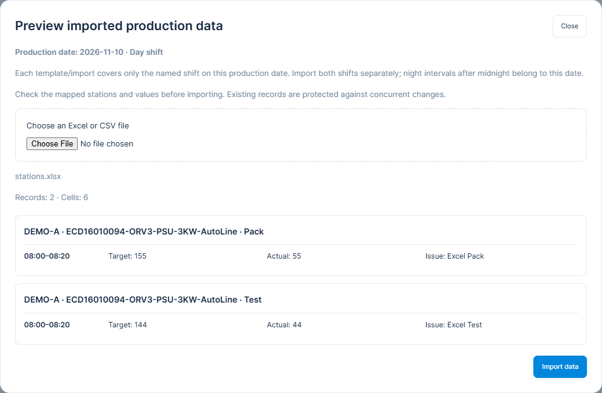

## Output source and monitoring

Each enabled line/model uses its selected **Output station** for dashboard target, output, gap, trends and alerts. Group totals add units, not every station traversed by the same products. Changing that source updates the active unit’s view immediately. Retired line/model combinations retain their captured historical source; saved station values remain intact.

Normal line clicks open details; full-screen clicks open a station-detail dialog. Closing retains the board group/page. Trend and share charts can be toggled independently. The fullscreen board uses seven units per page with compact single-row desktop cards, even with both charts enabled. Smaller screens scroll the list; additional units use pagination. Open details for the full model name. Phone daily-target cards retain field labels.

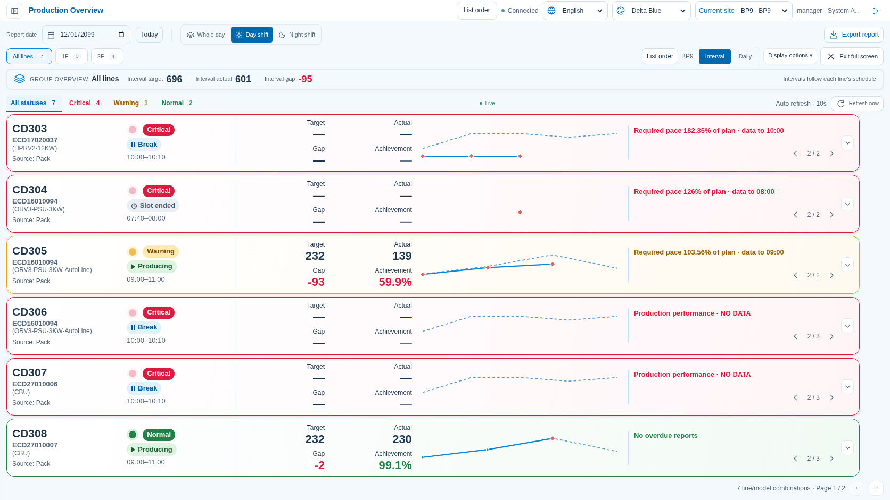

This pilot requires manual reporting; automatic data integration is planned for a future version. See the [manager walkthrough](./MANAGER_GUIDE.md), [member walkthrough](./MEMBER_GUIDE.md) and [validation record](./VALIDATION.md).

## Unified alerts and production states

Managers open **Settings → Alerts & refresh** (`/settings/alerts`), enable each policy, adjust thresholds, and **Save settings**. The three new policies start disabled. Existing shortfall/idle rules remain independently selectable. Planned UPH and deadline are now automatic; view the baseline in **Daily targets**.

| Policy | Default thresholds |
| --- | --- |
| Performance | Ended, reported production intervals only: Actual / corresponding Target. Green ≥95%, yellow ≥85%, red <85% |
| Completion risk | Required UPH / Planned UPH. Green ≤100%, yellow ≤110%, red >110% |
| Reporting | After a production interval ends: 10-minute grace, then yellow; another 30 minutes overdue becomes red |

Blank Actual is unreported; submitted **0** is a valid report. Breaks never require Actual. Backfilling clears reporting alerts automatically.

The completion forecast starts at the **last contiguous completed report**, divides remaining target by productive time from that cutoff to the deadline, and excludes breaks. Unreported production is unknown; it is never replaced with zero or recent average output. The reason includes the data cutoff, deadline and planned pace figures. Missing required data shows **NO DATA**; overdue reports mark **STALE**.

The overall light prioritizes **red over yellow**. Green requires every enabled check to be evaluable and normal; no data or all disabled is gray. Yellow pulses slowly, red quickly, green stays steady. Multiple reasons rotate every **5 seconds**, red first; the light does not change with the reason. Legacy blue/purple rules contribute yellow; optional frame flashing is separate. Open line details to read full reasons and all evaluations. Language changes translate reasons immediately.

**Producing / Break / Upcoming / Completed** describe the schedule independently of the signal. Break shows its time range, pauses idle counting, and preserves earlier production risks.

The existing schedule editor now has a daily timeline: theme colour = production, gray = break. Expand the labelled model's target preview to see its preset allocation. Edit the existing time/type controls; invalid clock times, overlaps (including midnight) and individual slots over 12 hours are flagged. Named templates still require selecting lines, applying and saving.

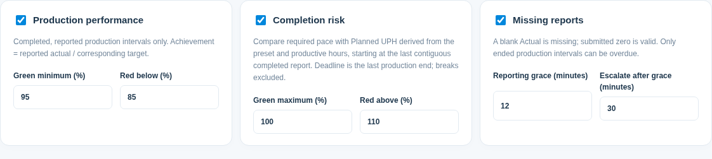
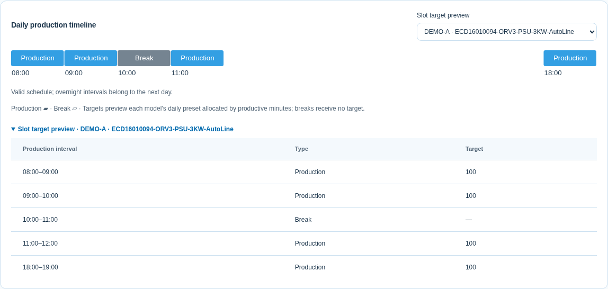

Thai, Chinese and English operation instructions are maintained together in the site's existing **User guide** (`/guide`).

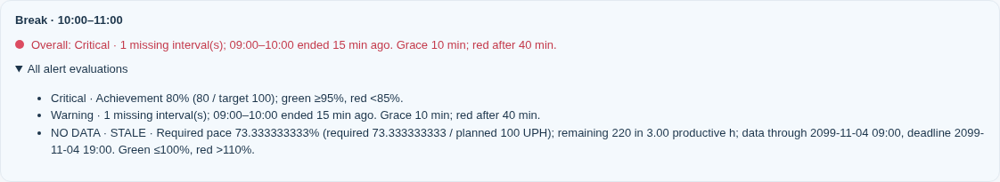

## Automatic Planned UPH

**Settings → Daily targets** shows read-only Planned UPH and productive hours for the full day and each shift. Planned UPH = target / productive hours, excluding breaks and unscheduled gaps. Day/Night use their allocated targets, so the full daily target is not counted twice. Target edits update the preview immediately; editing the line schedule recalculates it too. Save settings publishes the changes.

For a target of 400 across 3 day hours and 1 night hour, daily UPH is 100. Shift targets are 300/100 and each shift’s UPH is 100. Deadline is automatically the last production interval end in the evaluated plan; breaks are excluded and overnight production keeps its production date.

The risk expresses how much faster than the original planned pace is required; Planned UPH is not a physical machine capacity. Overall signals keep the existing whole-day scope. Missing targets or productive time show NO DATA. Historical forecasts use saved plans; if the original plan cannot be reconstructed, they also show NO DATA.

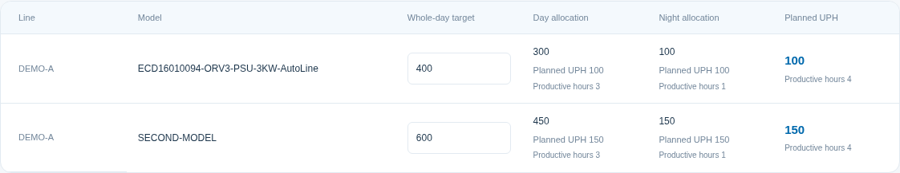
