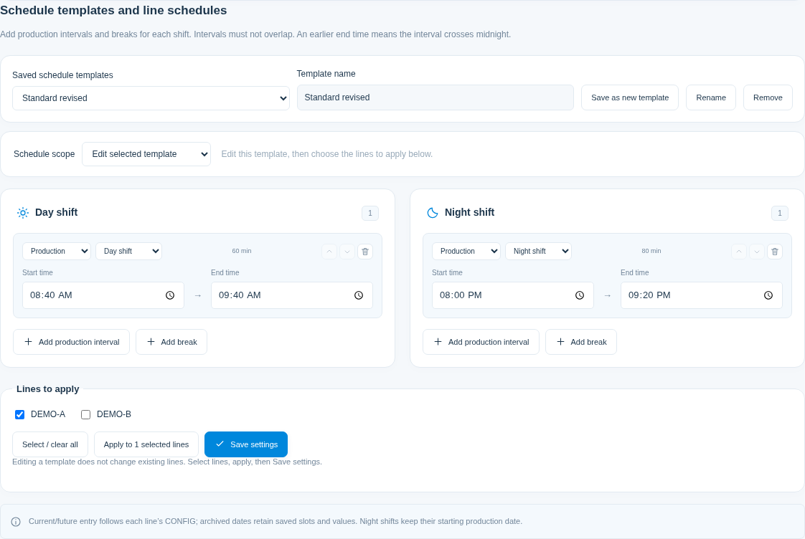

# 操作指南

先選適合帳號的教學，再依要完成的工作操作。應用程式左側的「使用說明」也依帳號顯示內容。

| 要完成的工作 | 教學 |
| --- | --- |
| 建立範本、套用線體、設定人員與站點 | [管理員教學](./MANAGER_GUIDE.md) |
| 填寫目標／實績、矩形貼上、批次、Excel | [填報員教學](./MEMBER_GUIDE.md) |
| English instructions | [English guide](./USER_GUIDE.en.md) |
| 查看測試範圍與結果 | [驗證紀錄](./VALIDATION.md) |

截圖使用獨立 DEMO 資料與 English 介面。Chinese／Thai 的按鈕位置相同，Target 是目標、Actual 是實績、Issue 是異常。每張圖只對應一項操作；應用程式中的圖片可按步驟展開，再點圖查看原尺寸。[步驟索引示例](./images/guide-steps.png)。

## 儲存及套用時間範本

入口：**設定 → 基礎資料與班別時間 → 班表範本與線體時段**。

1. 在「已儲存班表範本」選 **預設班表範本**，可修改原本的時間。
2. 要保留另一種排程，輸入名稱後按 **另存新範本**。可儲存多份，各自調整早晚班生產與休息時間。
3. 按 **儲存設定** 保存範本。只改範本不會自動改現有線體。
4. 在「選擇套用線體」勾選需要的線，按 **套用至所選線體**，確認後再按 **儲存設定**。
5. 在「班表範圍」選線體，可核對實際套用的時間；同一線的不同 Model 共用該線班表。

刪除範本不會刪除已套用的線體班表或填報。完整操作見[管理員班表教學](./MANAGER_GUIDE.md#各產線班表與共用範本)。

## 填寫生產資料

入口：**生產填報**，可直接開啟 `/entry`。

1. 核對生產日期、Line、Model，再選整日、單班或單時段。
2. 每站分別填 Target、Actual；離格自動儲存，確認 **Saved**。0 是確認零產出，空白是未填報。
3. 點異常摘要或按 F2 編輯 Issue；完成後自動儲存。
4. 同一時段多站一起填，使用工具列最左側的 **同時段批次填寫**；套用後仍可個別修改。

矩形每列對應下一站，相鄰 Target／Actual 欄留在同一時段；只有單欄資料才依上下列交錯目標／實績。超過剩餘容量的值忽略，不會繞到另一時段。

目前及未來生產日的主表、時段按鈕與 Excel 使用該線最新 CONFIG，已刪時段不會併回。已結束的過去生產日顯示當天已存的時段與數值，並標示「歷史已存班表」；尚在進行的跨午夜夜班仍使用目前班表。原始資料不會因刪除設定而清掉。

Excel 可下載整日雙班或單班範本，皆有 Target／Actual／Issue；先預覽、確認再匯入。**恢復預設** 會要求確認，還原目標並清除所選日期與 Line／Model 的實績、異常。詳見[填報員教學](./MEMBER_GUIDE.md)。

## 查看總覽與產線明細

入口：**生產總覽**，可直接開啟 `/overview`。

| 控制 | 作用 |
| --- | --- |
| 生產日期、全天／早班／晚班 | 選擇要查閱的資料範圍 |
| 時段／每日 | 切換卡片的目標、實績、差額；選擇會保留 |
| 產線曲線 | 顯示目標與實績；停留可看該時段數值 |
| 全螢幕 | 桌面每頁七組；顯示選項可開關分組趨勢、占比 |
| 點選產線 | 一般模式開明細頁；全螢幕開明細視窗 |

每日數字涵蓋雙班。警示與占比使用截至目前的累計規則；明細保留完整數字、逐時段記錄及早晚班人員。手機／平板圖表另佔一列，清單可捲動。

[完整總覽畫面](./images/production-overview.png) · [七線全螢幕畫面](./images/seven-line-board.png)
