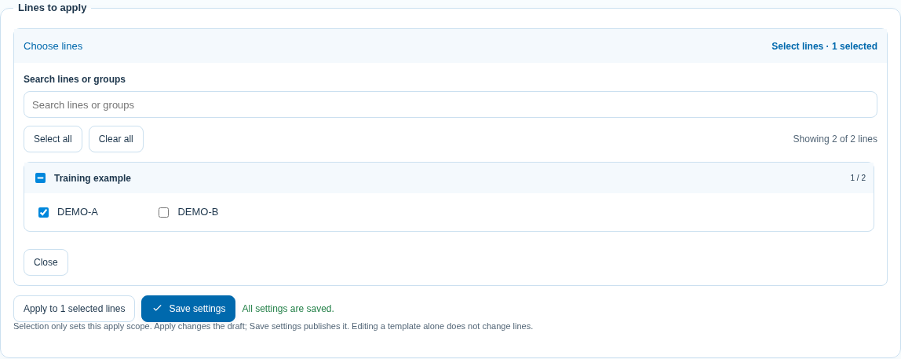
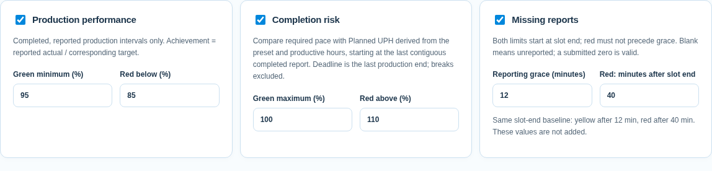
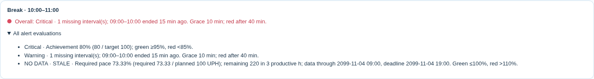
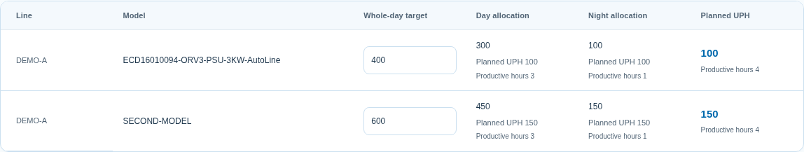
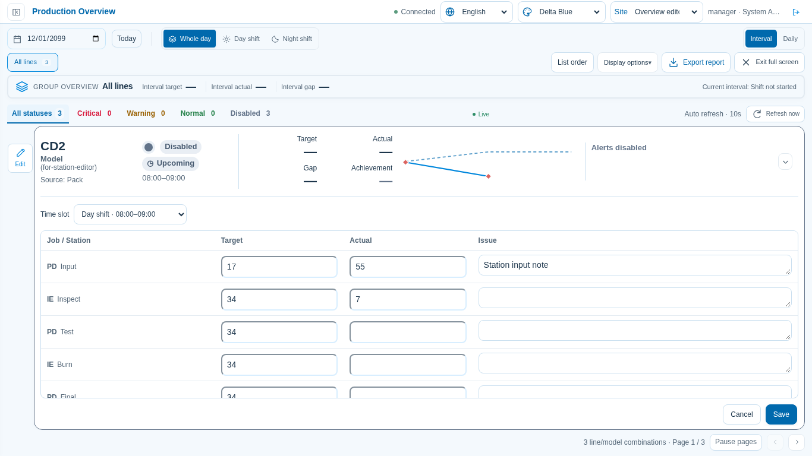
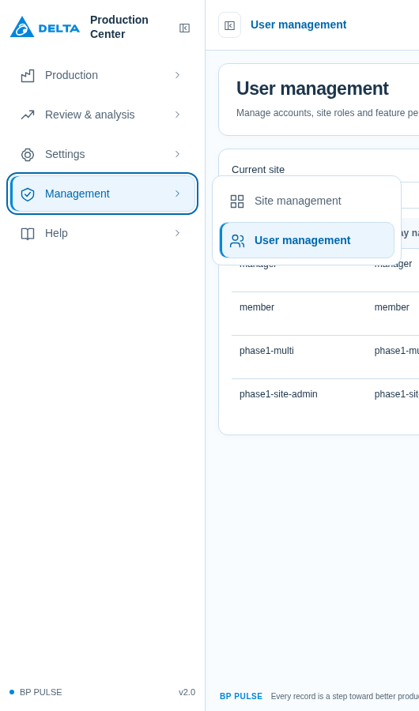

# 操作指南

## 登入與廠區

登入後選擇已授權的已啟用廠區；有效的上次選擇會自動使用。「記住我」保留 30 天登入，一般 Session 最長 8 小時。頂部「目前廠區」可切換，先處理未儲存填報，切換後會重載工作區。其他分頁若已變更廠區，舊分頁須重載。權限撤銷或廠區停用後不能再存取。

設定、日目標、清單、人員及生產資料都屬於目前廠區。System Admin 可管理廠區及全域帳號；Site Admin 只能管理目前廠區與普通使用者；User 依勾選功能操作，新帳號預設唯讀。詳細步驟見[多廠區與權限](./MULTI_SITE.md)。

先選適合帳號的教學，再依要完成的工作操作。應用程式左側「設定與說明 → 操作教學」也依帳號顯示內容。

| 要完成的工作 | 教學 |
| --- | --- |
| 建立範本、套用線體、設定人員與站點 | [管理員教學](./MANAGER_GUIDE.md) |
| 填寫目標／實績、矩形貼上、批次、Excel | [填報員教學](./MEMBER_GUIDE.md) |
| English instructions | [English guide](./USER_GUIDE.en.md) |
| 查看測試範圍與結果 | [驗證紀錄](./VALIDATION.md) |

截圖使用獨立 DEMO 資料與 English 介面。Chinese／Thai 的按鈕位置相同，Target 是目標、Actual 是實績、Issue 是異常。每張圖只對應一項操作；應用程式中的圖片可按步驟展開，再點圖查看原尺寸。[步驟索引示例](./images/guide-steps.png)。

## 儲存及套用時間範本

入口：**設定 → 基礎資料與班別時間 → 班表範本與線體時段**。

1. 在「已儲存班表範本」選 **預設班表範本**，可修改原本的時間。
2. 要保留另一種排程，輸入名稱後按 **另存新範本**。可儲存多份，各自調整早晚班生產與休息時間。
3. 按 **儲存設定** 保存範本。只改範本不會自動改現有線體。
4. 展開 **選擇產線**，可搜尋產線或分組、勾選整組／單線、全選及取消全選。已選數量包含搜尋暫時隱藏的線。按 **套用至所選線體** 確認後，再按 **儲存設定**。
5. 在「班表範圍」選線體，可核對實際套用的時間；同一線的不同 Model 共用該線班表。

勾選只決定本次套用範圍，不會自動改班表；套用後先成為草稿，旁邊顯示「尚有未儲存的設定」。按儲存後才顯示已儲存並分享給其他使用者。重新載入保留的是已套用班表，不是未套用的勾選。

全天時間軸以主題色表示生產、灰色表示休息。選擇目標預覽的產線／Model，展開即可核對各時段起訖與預設目標；時間重疊、無效或單段超過 12 小時會提示，請修正後再儲存。

刪除範本不會刪除已套用的線體班表或填報。完整操作見[管理員班表教學](./MANAGER_GUIDE.md#各產線班表與共用範本)。

## 填寫生產資料

入口：**生產填報**，可直接開啟 `/entry`。

1. 核對生產日期、Line、Model，再選整日、單班或單時段。
2. 每站分別填 Target、Actual；離格自動儲存，確認 **Saved**。0 是確認零產出，空白是未填報。
3. 點異常摘要或按 F2 編輯 Issue；完成後自動儲存。
4. 同一時段多站一起填，使用工具列最左側的 **同時段批次填寫**；套用後仍可個別修改。

矩形每列對應下一站，相鄰 Target／Actual 欄留在同一時段；只有單欄資料才依上下列交錯目標／實績。超過剩餘容量的值忽略，不會繞到另一時段。

目前及未來生產日的主表、時段按鈕與 Excel 使用該線最新 CONFIG，已刪時段不會併回。已結束的過去生產日顯示當天已存的時段與數值，並標示「歷史已存班表」；尚在進行的跨午夜夜班仍使用目前班表。原始資料不會因刪除設定而清掉。

Excel 可下載整日雙班或單班範本，皆有 Target／Actual／Issue；先預覽、確認再匯入。**恢復預設** 會要求確認，還原目標並清除所選日期與 Line／Model 的實績、異常。詳見[填報員教學](./MEMBER_GUIDE.md)。

## 查看總覽與產線明細

入口：**生產總覽**，可直接開啟 `/overview`。

| 控制 | 作用 |
| --- | --- |
| 生產日期、全天／早班／晚班 | 選擇要查閱的資料範圍 |
| 時段／每日 | 切換卡片目標、實績、差額及達成率；選擇會保留 |
| 狀態分頁 | 依嚴重、警告、正常、無資料或停用篩選，可搭配樓層分組 |
| 原因旁左右箭頭／卡片右側箭頭 | 手動切換原因／展開完整原因及所有告警判斷 |
| 產線曲線 | 顯示目標與實績；停留可看該時段數值 |
| 全螢幕 | 依可用高度分頁；顯示選項可開關輔助區塊與圖表並重算容量 |
| 點選產線 | 一般模式開明細頁；全螢幕開明細視窗 |

一般／全螢幕統一依 **日期與範圍篩選 → 分組總覽 → 告警摘要與篩選 → 產線卡片 → 詳細圖表** 排列。全螢幕同樣可調日期及班別；圖表開啟後位於卡片下方，不會把卡片文字擠小。

桌面卡片維持單列橫向：**產線／機種 → 燈號與狀態 → Target／Actual／Gap／Achievement → 曲線 → 目前時段 → 告警摘要**。長機種以省略號顯示，停留或明細可看完整名稱。四項數值使用共用等高 Grid、固定欄位及等寬數字；有空間就顯示完整值，不足才採本地化 K／M 等短格式，停留或開明細可看精確值。各產線曲線位置與尺寸一致，不隨數字、機種或告警長度變動。中等寬度統一將數值排成兩列，避免縮小字體或擠壓曲線。一般與全螢幕都在卡片下方查看完整警報，不使用編輯表單或重複數據。

一般模式**每頁最多七組**；全螢幕依控制區、分組總覽、篩選及額外圖表占用後的可用高度，顯示最多七組。較矮視窗會自動減少每頁數量，超出資料一律換頁，**全螢幕整頁不需垂直捲動**。當頁卡片會均分剩餘高度，1～5 條或最後一頁筆數較少時不留大片底部空白；字體保持不變，曲線最多增加至 104px。6～7 條仍維持緊湊橫列。開啟額外圖表會重新計算容量。

全螢幕按 **顯示選項**，勾選分組總覽、告警摘要、篩選列、頁面標題、輪播控制，以及額外的分組趨勢／產量占比。修改立即生效並保存在目前瀏覽器，離開、重新進入或重新整理後仍保留；不會更改共用設定或生產資料。隱藏的篩選仍保持套用，輪播控制隱藏時自動換頁仍依原設定運作。隱藏區塊後卡片自動均分騰出的空間，顯示選項與離開全螢幕始終保留。按 **還原顯示預設** 可還原；一般模式不受這些顯示開關影響。Esc 先關閉選單，再按才離開全螢幕。

[共用欄位與六位數畫面](./images/shared-grid-numbers.png) · [全螢幕顯示選項](./images/fullscreen-display-options.png)

上一頁向右、下一頁（含最後回第一頁）向左滑動並淡入淡出，約 600ms；前後頁分別保留完整布局，切頁期間不將文字縮放。啟用系統「減少動態效果」時，直接換頁。資料刷新更新原節點，不重新播放切頁動畫。

上一頁／下一頁旁顯示目前與總頁數。管理員在 **設定 → 警示與刷新 → 產線分頁自動切換（秒）** 設秒數（新預設 12；0 停用）並儲存；已儲存的自訂間隔會保留。可按 **暫停換頁／恢復換頁** 控制目前瀏覽器的輪播；手動切頁及恢復後都重新等待完整間隔。彈窗、暫時側欄、一般模式展開卡片、卡片內焦點或背景分頁會暫停輪播。篩選變更後重算頁數；調整視窗或進出全螢幕時盡量保留目前產線所在頁，換頁不重建分組、篩選及其他圖表。

實測標準版面：1920×1080 每頁七組、1600×900 五組、1366×768 四組；實際數量也會隨圖表及控制項換行調整。
[五條自適應畫面](./images/fullscreen-adaptive-5.png) · [三條](./images/fullscreen-adaptive-3.png) · [一條](./images/fullscreen-adaptive-1.png)

[1920×1080 實際畫面](./images/fullscreen-1920.png) · [1600×900](./images/fullscreen-1600.png) · [1366×768](./images/fullscreen-1366.png)

左側導覽依生產、查詢與分析、設定與說明分組。桌面可收合成圖示，停留顯示名稱，收合狀態會保留；小螢幕及全螢幕由頂部選單按鈕開暫時側欄，選頁、點外面或 Escape 關閉。右上角保留語言、主題及帳號，路由及權限不變。

一般目錄、選項及產線清單使用個人清單排序，未設定時保留來源順序；站點流程仍依配置、班表仍依時間先後。排序不改共用設定或已選項目。

每日數字涵蓋雙班。告警獨立於數字模式；明細保留完整數字、逐時段記錄及早晚班人員。窄容器中的圖表另佔一列；一般模式可正常捲動，全螢幕則減少每頁數量。

[完整總覽畫面](./images/production-overview.png) · [全螢幕分頁畫面](./images/seven-line-board.png)

## 告警設定與狀態判讀

管理員入口：**設定 → 警示與刷新**（`/settings/alerts`）。

1. 勾選要啟用的「生產達成率」、「完工風險」、「資料未回報」，或既有缺口／停滯規則。新增三項預設停用，請按需要啟用。
2. 調整門檻即可。計畫 UPH 與截止時間會自動計算，無需另外設定產能基準。
3. 按 **儲存設定**，重新整理後仍保留。僅修改草稿不會改看板。

| 規則 | 預設判斷 |
| --- | --- |
| 生產達成率 | 已結束且有回報的生產時段，實績合計 ÷ 對應目標合計；綠 ≥95%，黃 ≥85%，紅 <85% |
| 完工風險 | 需求 UPH ÷ 計畫 UPH；綠 ≤100%，黃 ≤110%，紅 >110% |
| 資料未回報 | 門檻均從生產時段結束起算：預設超過 10 分鐘亮黃，超過總共 40 分鐘亮紅；補填即解除 |
| 既有缺口／停滯 | 依各規則數量／秒數門檻判斷；停滯計時排除休息及班外時間，休息不自動解除已觸發風險 |

**寬限**與**結束後升紅燈**都以時段結束為起點。例：寬限 30、升紅燈 45 → 超過 30 分鐘黃燈、超過 45 分鐘紅燈，不再相加。升紅燈時間不可小於寬限。舊版「寬限＋額外等待」會先換算為原有效總時間（30＋45 顯示 75），避免默默改動既有規則；請核對後改成需要的總分鐘數並儲存。

Actual 空白是未回報；已提交 **0** 是有效回報。休息段不需填 Actual。

完工風險以**最後連續完整回報時段**為資料基準，將剩餘目標分配至該基準到截止時間的有效生產工時，排除休息。未回報期間產量仍未知，不會用零或最近平均產量代替。原因會列出資料截止、截止時間、需求與計畫 UPH；缺少必要資料顯示**無資料**，回報逾期標示**資料過期（STALE）**，請先補填。

總燈號 **紅優先於黃**；全部已啟用項目都有資料且正常才亮綠。無資料或全部停用顯示灰色。黃燈慢閃、紅燈快閃，綠燈常亮；多個原因每 **5 秒**輪播，紅色原因先顯示，**燈號不隨文字切換**。既有藍／紫規則以黃燈納入總燈號，外框閃爍選項獨立保留。

卡片顯示最多兩行的本地化短摘要，停留或按右側箭頭可看完整原因與「所有告警判斷」。原因旁左右箭頭可手動切換，之後仍每 5 秒輪播；點產線名稱或展開區的明細按鈕可前往完整生產細節。切換語言會同步翻譯。**生產中／休息中／尚未開始／已結束**是班表狀態，與燈號分開判讀；休息會顯示起訖，仍可能有前段生產風險。

## 自動計畫 UPH

入口：**設定 → 產線日目標**（`/settings/daily-targets`）。

- **計畫 UPH＝目標 ÷ 有效生產時數**。工時只計生產段，排除休息與未排生產的空檔。
- 表格顯示全天計畫 UPH、有效工時；早晚班目標下方顯示各班的 UPH 與工時，使用該班分配目標，避免重複計算日目標。
- 修改日目標會即時更新預覽；調整線體班表後也會重算，按「儲存設定」發布。UPH 為唯讀欄位。
- 例如日目標 400、早班 3 小時、晚班 1 小時，全天 UPH 為 100；兩班分配 300／100，各班 UPH 都是 100。
- 完工截止自動取對應計畫最後生產段的結束時間，休息不延長截止，午夜後的夜班仍屬原生產日。

完工風險表示**需要比原計畫速度加快多少**，計畫 UPH 並非設備實際最大產能。總燈號仍採原本的全天評估範圍。缺少目標、有效工時為零時顯示無資料；歷史使用已存計畫，無法還原原始計畫時也會顯示無資料。

## 總覽工具列與多站點填報

- 第一排：日期、今天、全天／早班／晚班，右側切換時段／每日。第二排：左側篩選產線／樓層，右側為清單排序、顯示選項、匯出報表、全螢幕。分組總覽及狀態列位於下方。
- 頂部「廠區」只顯示名稱，名稱缺少才顯示代碼；同名代碼不會重複拼接。切換仍只列有權限的廠區。
- 「清單排序」可調整本人在目前廠區的顯示順序，拖曳或按上下箭頭會自動儲存於資料庫；重新登入仍保留，不改共用設定或站點流程。
- 卡片上的數字保持唯讀。滑入或向右滑動卡片，左側露出「編輯」；鍵盤 Tab 聚焦也可操作。點擊後在下方左上角選時段，逐站填目標、實績與異常。站點依目前產線／Model／廠區設定載入；日期與班別範圍沿用頁面，不重複選擇。此處沒有快捷文字或批次套用。
- 只有改過的欄位會提交。實績空白是未回報，0 是有效回報。按底部儲存後收合並更新卡片；取消不寫入。若其他人已修改相同站點，整批拒絕並保留輸入，請取消後重新載入確認最新資料。
- 切換時段前會提示未儲存修改，不會把前一時段輸入帶到新時段。連線或儲存失敗保留草稿，可重試。切換全螢幕保留草稿；編輯時暫停輪播，表格可在區域內捲動。
- 右側箭頭只展開完整警報與已填異常，包括實際原因、數值、時段、站點及已有的更新資訊。沒有警報時顯示「目前無警報」。查看與編輯兩種模式互斥。

## 側欄分類

五個分類為生產作業、查詢分析、設定、管理、說明。滑鼠滑入、鍵盤聚焦或點擊分類，右側會浮出功能選單；移開後收合，按 Escape 關閉。手機可點擊操作。管理包含原有廠區管理與使用者管理，保留原路由及權限，不推動其他導覽項目。

